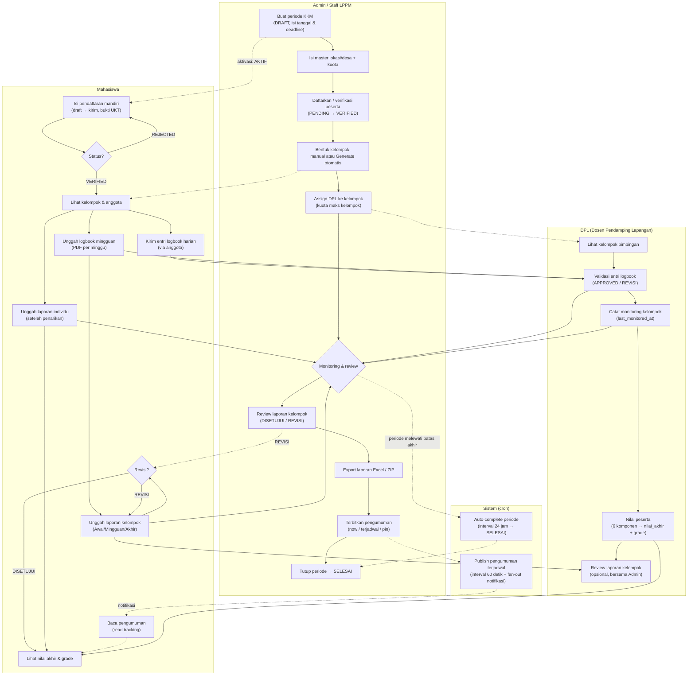
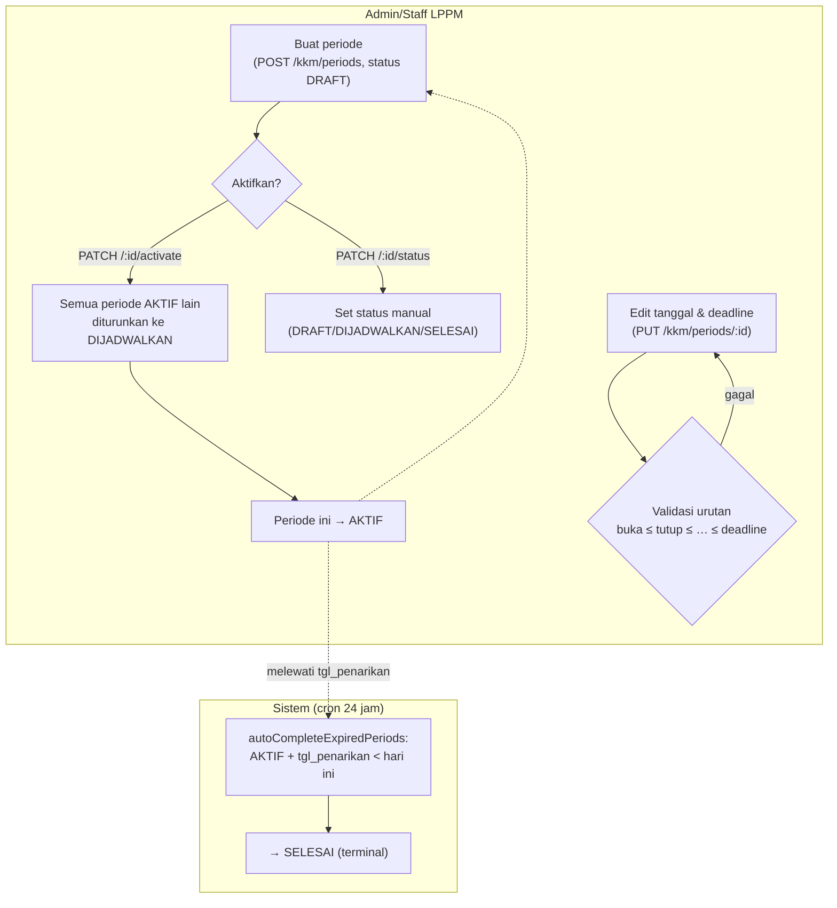
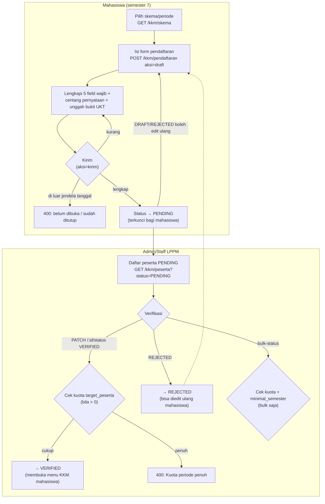
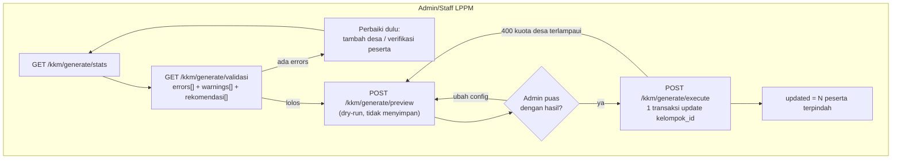
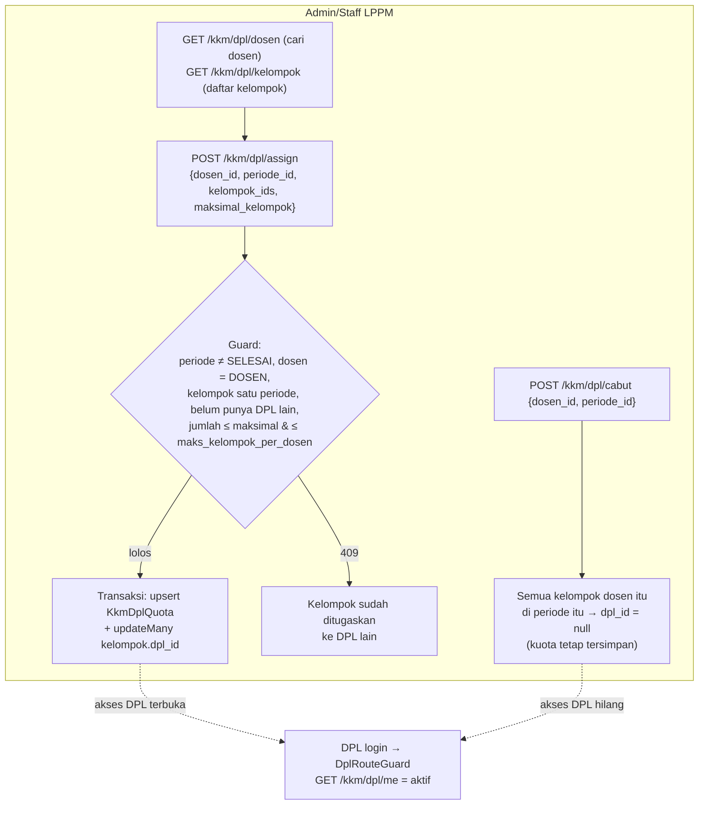
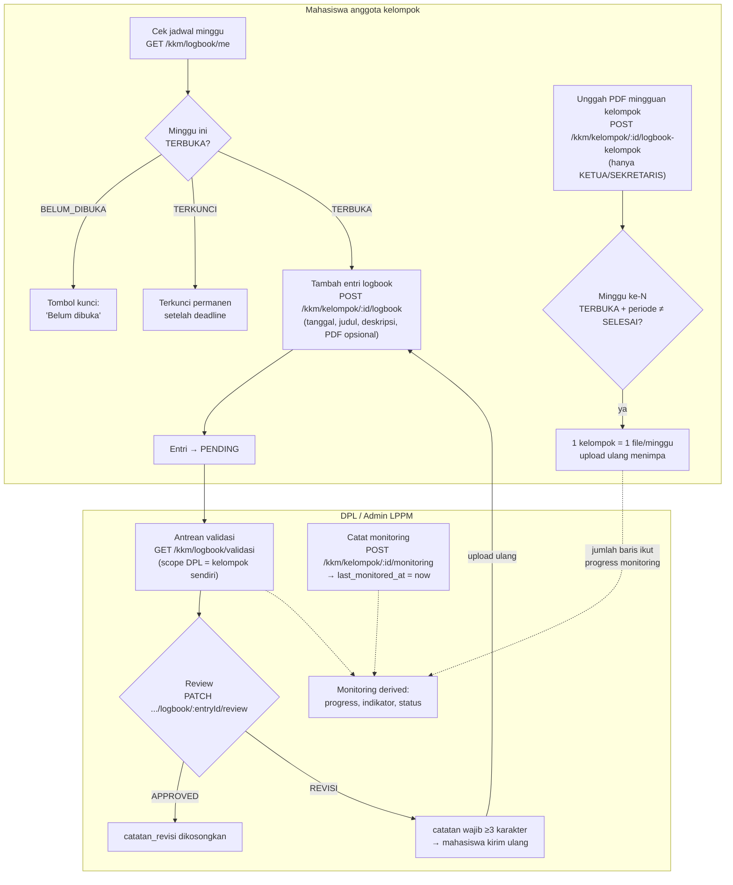
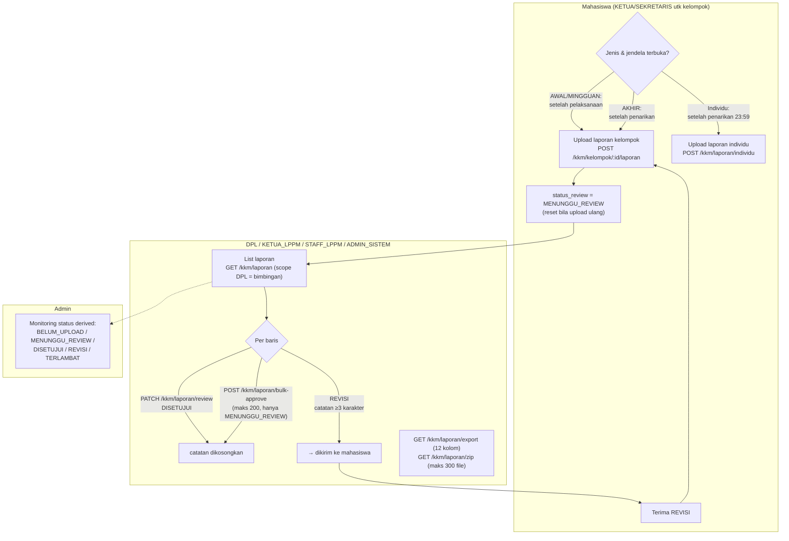
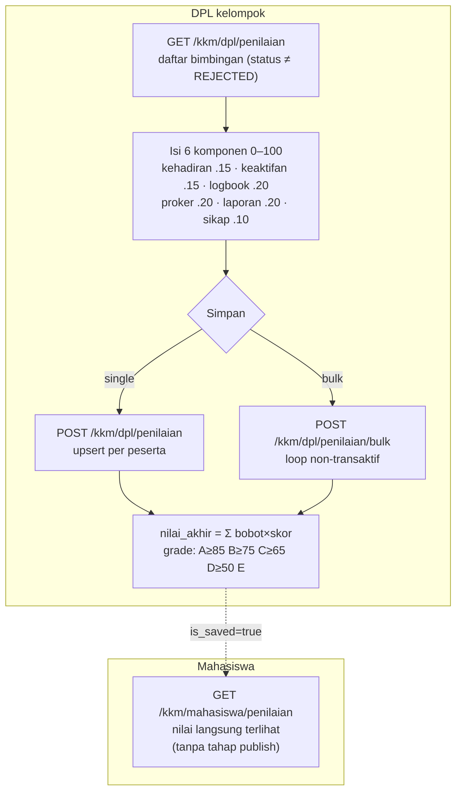
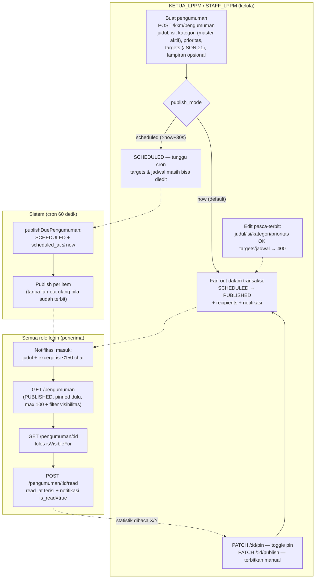

# PRD — Modul KKM (Kuliah Kerja Mahasiswa)

> **Tipe:** Dokumentasi sistem *as-is* (bukan usulan fitur baru).
> **Sumber:** dibaca langsung dari kode BE (`sip3m-be`) dan FE (`sip3m-fe`).
> **Versi dokumen:** 1.0 · **Tanggal:** 23 November 2026
> **Untuk:** kontrak spesifikasi bagi pengembang/AI yang mengerjakan modul ini.

---

## Daftar Isi

1. [Ringkasan Modul](#1-ringkasan-modul)
2. [Role & Permission Matrix](#2-role--permission-matrix)
3. [Data Model](#3-data-model)
4. [State Machine](#4-state-machine)
5. [Daftar Endpoint Lengkap](#5-daftar-endpoint-lengkap)
6. [Swimlane End-to-End](#6-swimlane-end-to-end)
7. [Swimlane per Alur Fitur](#7-swimlane-per-alur-fitur)
8. [Aturan Bisnis per Fitur](#8-aturan-bisnis-per-fitur)
9. [Cron & Tugas Terjadwal](#9-cron--tugas-terjadwal)
10. [Dashboard KKM](#10-dashboard-kkm)
11. [Frontend: Route, Menu & Halaman per Role](#11-frontend-route-menu--halaman-per-role)
12. [Kriteria Selesai (Acceptance Criteria)](#12-kriteria-selesai-acceptance-criteria)
13. [Temuan (Inkonsistensi / Bug)](#13-temuan-inkonsistensi--bug)

---

## 1. Ringkasan Modul

Modul KKM mengelola siklus penuh **Kuliah Kerja Mahasiswa**: dari pembukaan periode oleh admin LPPM, pendaftaran mahasiswa, pembentukan kelompok (manual oleh admin atau otomatis via *generate*), penempatan DPL (Dosen Pendamping Lapangan), pelaksanaan yang dipantau lewat logbook mingguan, penilaian oleh DPL, pengumpulan laporan (individu & kelompok) beserta proses review-nya, hingga pengumuman dan penutupan periode.

### 1.1 Aktor

| Aktor | Role sistem | Peran dalam modul KKM |
|---|---|---|
| Mahasiswa | `MAHASISWA` | Mendaftar KKM, mengisi form pendaftaran, melihat kelompok & logbook sendiri, mengunggah logbook/laporan, melihat penilaian |
| DPL (Dosen Pendamping Lapangan) | `DOSEN` | Memvalidasi & mereview logbook, mencatat monitoring kelompok, menilai peserta |
| Admin LPPM | `KETUA_LPPM` | Mengelola periode/lokasi/DPL/peserta/kelompok, generate kelompok, review laporan, mengelola pengumuman |
| Staff LPPM | `STAFF_LPPM` | Sama seperti admin LPPM untuk sebagian besar operasi (mengikuti permission yang diberikan ke role-nya) |
| Admin Sistem | `ADMIN_SISTEM` | Master data & permission (di luar scope inti modul KKM) |
| Sistem (cron) | — | Auto-complete periode tiap 24 jam, publish pengumuman terjadwal tiap 60 detik |

### 1.2 Submodul BE (14 folder di `src/kkm/`)

| # | Submodul | Fungsi inti |
|---|---|---|
| 1 | `periods` | CRUD periode KKM, aktivasi, auto-complete via cron |
| 2 | `skema` | Portal daftar skema/lokasi KKM (read-only, untuk halaman publik) |
| 3 | `locations` | Master lokasi/desa per periode + kuota |
| 4 | `dpl` | Daftar DPL, assign/cabut DPL ke kelompok, kuota DPL, middleware `requireDplAktif` |
| 5 | `peserta` | Data peserta per periode: verifikasi status, assign kelompok, export |
| 6 | `pendaftaran` | Form pendaftaran mandiri mahasiswa (draft/kirim + bukti UKT) |
| 7 | `generate` | Generate kelompok otomatis: stats → validasi → preview → execute |
| 8 | `kelompok` | CRUD kelompok, anggota, jabatan, dokumen kelompok |
| 9 | `monitoring` | Monitoring kelompok + logbook per entri (kirim, validasi, review) |
| 10 | `logbook-kelompok` | Unggah PDF logbook mingguan per kelompok (riwayat per minggu) |
| 11 | `penilaian` | DPL menilai peserta (single & bulk), mahasiswa melihat nilai |
| 12 | `laporan` | Laporan individu & kelompok, review, bulk-approve, export Excel/ZIP |
| 13 | `pengumuman` | Pengumuman bertarget + jadwal publish + statistik dibaca |
| 14 | `jabatan-master` | Master jabatan kelompok dinamis |

Di luar folder `src/kkm/`: **`GET /api/dashboard/kkm`** (`src/dashboard/`) — agregasi dashboard KKM.

---

## 2. Role & Permission Matrix

### 2.1 Role sistem (`src/auth/role.ts`)

`KETUA_LPPM` · `ADMIN_SISTEM` · `STAFF_LPPM` · `DOSEN` · `REVIEWER` · `REVIEWER_EKSTERNAL` · `MAHASISWA`

> `REVIEWER`/`REVIEWER_EKSTERNAL` tidak punya permission KKM (khusus modul proposal penelitian).

### 2.2 Permission KKM (35 konstanta `KKM_*` + 1 dashboard)

| Konstanta | Nilai string | Dipakai di |
|---|---|---|
| `KKM_JABATAN_KELOLA` | `kkm.jabatan.kelola` | POST/PATCH/DELETE `/kkm/jabatan-master*` |
| `KKM_PERIODE_LIHAT` | `kkm.periode.lihat` | GET `/kkm/periods` |
| `KKM_PERIODE_DETAIL` | `kkm.periode.detail` | GET `/kkm/periods/:id` |
| `KKM_PERIODE_KELOLA` | `kkm.periode.kelola` | POST `/kkm/periods`, POST `/kkm/periods/run-auto-complete`, PUT/PATCH `/kkm/periods/:id*` |
| `KKM_SKEMA_LIHAT` | `kkm.skema.lihat` | GET `/kkm/skema` |
| `KKM_LOKASI_LIHAT` | `kkm.lokasi.lihat` | GET `/kkm/locations`, `/stats`, `/:id` |
| `KKM_LOKASI_KELOLA` | `kkm.lokasi.kelola` | POST/PUT/DELETE `/kkm/locations*` |
| `KKM_DPL_LIHAT` | `kkm.dpl.lihat` | GET `/kkm/dpl`, `/kkm/dpl/stats` |
| `KKM_DPL_KELOLA` | `kkm.dpl.kelola` | GET `/kkm/dpl/dosen`, `/kelompok`; POST `/assign`, `/cabut` |
| `KKM_PESERTA_LIHAT` | `kkm.peserta.lihat` | GET `/kkm/peserta`, `/stats`, `/:id` |
| `KKM_PESERTA_KELOLA` | `kkm.peserta.kelola` | PATCH `/bulk-status`, POST `/assign-kelompok`, PATCH `/:id/status` |
| `KKM_PESERTA_EXPORT` | `kkm.peserta.export` | GET `/kkm/peserta/export` |
| `KKM_GENERATE_LIHAT` | `kkm.generate.lihat` | GET `/kkm/generate/stats`, `/validasi`, GET+POST `/preview` |
| `KKM_GENERATE_JALANKAN` | `kkm.generate.jalankan` | POST `/kkm/generate/execute`, POST `/kkm/kelompok/generate` |
| `KKM_KELOMPOK_LIHAT` | `kkm.kelompok.lihat` | GET `/kkm/kelompok`, `/stats` |
| `KKM_KELOMPOK_DETAIL` | `kkm.kelompok.detail` | GET `/kkm/kelompok/:id` |
| `KKM_KELOMPOK_SAYA` | `kkm.kelompok.saya` | GET `/kkm/kelompok/me` |
| `KKM_KELOMPOK_KELOLA` | `kkm.kelompok.kelola` | PATCH `/kkm/kelompok/:id`, anggota CRUD, jabatan, dokumen |
| `KKM_MONITORING_LIHAT` | `kkm.monitoring.lihat` | GET `/kkm/monitoring` |
| `KKM_LOGBOOK_VALIDASI` | `kkm.logbook.validasi` | GET `/kkm/logbook/validasi`, `/validasi/:entryId` |
| `KKM_LOGBOOK_LIHAT` | `kkm.logbook.lihat` | GET `/kkm/kelompok/:id/logbook` |
| `KKM_LOGBOOK_SAYA` | `kkm.logbook.saya` | GET `/kkm/logbook/me` |
| `KKM_LOGBOOK_KIRIM` | `kkm.logbook.kirim` | POST `/kkm/kelompok/:id/logbook` |
| `KKM_LOGBOOK_REVIEW` | `kkm.logbook.review` | PATCH `.../logbook/:entryId/review`, POST `.../monitoring` |
| `KKM_LOGBOOK_KELOMPOK_KIRIM` | `kkm.logbook-kelompok.kirim` | GET `/kkm/logbook-kelompok/me`, POST `/kkm/kelompok/:id/logbook-kelompok` |
| `KKM_LAPORAN_INDIVIDU` | `kkm.laporan.individu` | GET `/kkm/laporan/individu/me`, POST `/kkm/laporan/individu` |
| `KKM_LAPORAN_KELOMPOK` | `kkm.laporan.kelompok` | GET `/kkm/laporan/kelompok/me`, POST `/kkm/kelompok/:id/laporan` |
| `KKM_LAPORAN_LIHAT` | `kkm.laporan.lihat` | GET `/kkm/laporan`, `/detail` |
| `KKM_LAPORAN_REVIEW` | `kkm.laporan.review` | PATCH `/kkm/laporan/review`, POST `/kkm/laporan/bulk-approve` |
| `KKM_LAPORAN_EXPORT` | `kkm.laporan.export` | GET `/kkm/laporan/export`, `/zip` |
| `KKM_PENDAFTARAN` | `kkm.pendaftaran` | GET `/kkm/pendaftaran/me`, POST `/kkm/pendaftaran` |
| `KKM_PENILAIAN_ISI` | `kkm.penilaian.isi` | GET/POST `/kkm/dpl/penilaian`, POST `/kkm/dpl/penilaian/bulk` |
| `KKM_PENILAIAN_LIHAT` | `kkm.penilaian.lihat` | GET `/kkm/mahasiswa/penilaian` |
| `KKM_PENGUMUMAN_LIHAT` | `kkm.pengumuman.lihat` | GET `/kkm/pengumuman`, `/kkm/pengumuman/:id` |
| `KKM_PENGUMUMAN_KELOLA` | `kkm.pengumuman.kelola` | POST/PATCH/DELETE `/kkm/pengumuman*` |
| `DASHBOARD_KKM` | `dashboard.kkm` | GET `/dashboard/kkm` (di `src/dashboard/`) |

**Endpoint tanpa `requirePermission` (7):** `GET /kkm/periods/active`, `GET /kkm/dpl/me`, `GET /kkm/jabatan-master`, `GET /kkm/jabatan-master/:id`, `GET /pengumuman`, `GET /pengumuman/:id`, `POST /pengumuman/:id/read` — tetap butuh `authMiddleware`.

> **Pemetaan permission → role** ada di `prisma/seed-permissions.ts` (`ROLE_GRANTS`, baris 133–208), bukan di route:
>
> | Role | Permission KKM utama |
> |---|---|
> | `KETUA_LPPM` | `kkm.kelompok.lihat/detail/kelola`, `kkm.monitoring.lihat`, `kkm.logbook.validasi/lihat/review`, `kkm.laporan.lihat/review/export`, `kkm.pengumuman.lihat/kelola`, + semua `kkm.periode/lokasi/dpl/peserta/generate` |
> | `STAFF_LPPM` | sama dengan KETUA_LPPM **kecuali tanpa** `kkm.kelompok.kelola` dan `kkm.pengumuman.kelola` |
> | `DOSEN` | `kkm.kelompok.detail`, `kkm.monitoring.lihat`, `kkm.logbook.validasi/lihat/kirim/review`, `kkm.laporan.lihat/review`, `kkm.penilaian.isi` |
> | `MAHASISWA` | `kkm.kelompok.saya`, `kkm.logbook.saya/lihat/kirim`, `kkm.logbook-kelompok.kirim`, `kkm.laporan.individu/kelompok`, `kkm.penilaian.lihat` |
> | `ADMIN_SISTEM` | `kkm.jabatan.kelola`, `kkm.pengumuman.lihat`, + **superuser** (selalu lolos `requirePermission`) |
>
> Pemetaan menu/halaman per role di FE lihat [Bagian 11](#11-frontend-route-menu--halaman-per-role).

---

## 3. Data Model

Semua model KKM di `prisma/schema.prisma`.

### 3.1 Entitas & relasi

```
KkmPeriod ─┬─< KkmLocation (1 desa, unique per periode+kab+kec+desa, punya kuota)
           ├─< KkmKelompok (unique lokasi_id → 1 kelompok per desa)
           │     ├─< KkmPeserta (kelompok_id nullable)
           │     ├─< KkmKelompokDocument (unique kelompok+jenis)
           │     ├─< KkmLogbookEntry (catatan harian per anggota)
           │     └─< KkmLogbookKelompok (PDF mingguan, unique kelompok+minggu_ke)
           ├─< KkmPeserta (unique periode+user; jabatan → JabatanKelompokMaster)
           │     ├─1 KkmPenilaian (unique peserta)
           │     └─1 KkmLaporanIndividu (unique peserta)
           ├─< KkmDplQuota (unique periode+dosen: maksimal_kelompok)
           └─< KkmLogbookKelompok / KkmLaporanIndividu (FK periode)

KkmKelompok >─ users (dpl_id, onDelete SetNull)  — DPL kelompok
users >─ Fakultas / ProgramStudi
JabatanKelompokMaster (nama unique, max_per_kelompok nullable)

Pengumuman ─┬─< PengumumanTarget (unique pengumuman+target_type+ref_id)
            ├─< PengumumanRecipient (unique pengumuman+user, read_at = statistik baca)
            └─< Notifications (fan-out notifikasi)
```

### 3.2 Kolom penting `KkmPeriod` (konfigurasi siklus + deadline)

| Kelompok | Field | Keterangan |
|---|---|---|
| Identitas | `nama_periode`, `tahun_akademik` (`YYYY/YYYY` berurutan), `tahun`, `jenis` (`REGULER`\|`TEMATIK`), `deskripsi` | unique `nama_periode + tahun_akademik` |
| Tanggal siklus | `tgl_buka_daftar` → `tgl_tutup_daftar` → `tgl_pembekalan` → `tgl_pelaksanaan` → `tgl_penarikan` → `deadline_laporan` | wajib berurutan (divalidasi Zod `superRefine`) |
| Logbook individu | `logbook_individu_hari` (1=Sen…7=Min), `logbook_individu_jam` (`HH:mm`, default 23:59) | minggu ke-1 mulai `tgl_pelaksanaan`, minggu terakhir berakhir di `tgl_penarikan` |
| Logbook kelompok | `logbook_kelompok_hari`, `logbook_kelompok_jam` | deadline mingguan diatur admin |
| Laporan individu | `deadline_laporan_individu`, `jam_laporan_individu` | buka setelah `tgl_penarikan` |
| Laporan kelompok | `deadline_laporan` + `jam_laporan_kelompok` (jenis AKHIR); `deadline_laporan_awal` + `jam_laporan_awal`; `deadline_laporan_mingguan` + `jam_laporan_mingguan` | deadline terpisah per jenis |
| Batasan peserta | `target_peserta` (default 0), `minimal_semester` (1–14), `maks_anggota_kelompok` (default 10), `boleh_lintas_fakultas` (default false), `wajib_campur_prodi` (default false) | |
| DPL | `assign_dpl_otomatis` (default false), `maks_kelompok_per_dosen` | |
| Status | `status` `KkmPeriodStatus` default `DRAFT` | |

### 3.3 Kolom penting model lain

| Model | Kolom kunci |
|---|---|
| `KkmLocation` | `kabupaten`, `kecamatan`, `desa`, `kuota`; status **Penuh/Tersedia = derived** (bukan kolom); unique per periode |
| `KkmKelompok` | `nama` (≤50), `lokasi_id` **unique** (1 kelompok = 1 desa), `dpl_id` nullable, `last_monitored_at` (timestamp monitoring DPL) |
| `KkmPeserta` | `status` (`DRAFT\|PENDING\|VERIFIED\|REJECTED`), `jabatan_id`, form pendaftaran: `no_wa`, `ukuran_jaket`, `nama_kontak_darurat`, `no_hp_kontak_darurat`, `alamat_domisili`, `bukti_ukt_path`; unique `periode+user` |
| `KkmKelompokDocument` | `document_type` (`PROPOSAL_PROGRAM_KERJA\|LOGBOOK_KELOMPOK\|LAPORAN_AWAL\|LAPORAN_MINGGUAN\|LAPORAN_AKHIR`), `status_review` (`MENUNGGU_REVIEW\|DISETUJUI\|REVISI`), `catatan_revisi`, `reviewed_by/at`; unique `kelompok+jenis` (upload menimpa) |
| `KkmLogbookEntry` | `tanggal`, `judul`, `deskripsi`, `lokasi_kegiatan`, `status` (`PENDING\|APPROVED\|REVISI`), `file_path` (PDF opsional), `catatan_revisi`, `reviewed_by/at` |
| `KkmLogbookKelompok` | `minggu_ke` (1-based dari `tgl_pelaksanaan`), `file_path`, `uploaded_by`; unique `kelompok+minggu_ke` (upload ulang menimpa) |
| `KkmLaporanIndividu` | 1 baris per mahasiswa, `file_path`, unique `peserta` |
| `KkmPenilaian` | komponen 0–100: `kehadiran`, `keaktifan`, `logbook`, `program_kerja`, `laporan`, `sikap`; `nilai_akhir`, `grade` (default "E"), `catatan_dpl`, `is_saved`, `dinilai_oleh/at`; unique `peserta` |
| `KkmDplQuota` | `maksimal_kelompok`, unique `periode+dosen` |
| `JabatanKelompokMaster` | `nama` unique, `max_per_kelompok` (null = unlimited) |
| `Pengumuman` | `judul`, `isi`, `kategori`, `prioritas` (`PENTING\|SEDANG\|INFORMASI`), `status` (`SCHEDULED\|PUBLISHED`), `published_at`, `scheduled_at`, `is_pinned`, lampiran (Supabase `lppm_documents`) |
| `PengumumanTarget` | `target_type` (`PESERTA\|DPL\|KELOMPOK\|DESA\|PERIODE\|FAKULTAS`), `ref_id` (wajib untuk `KELOMPOK/DESA/PERIODE/FAKULTAS`) |
| `PengumumanRecipient` | `read_at` (null = belum dibaca → statistik "dibaca X/Y") |

### 3.4 File & storage

- Bucket Supabase: **`lppm_documents`**.
- Upload PDF logbook/laporan: **maks 10 MB, hanya PDF** (multer memory + validasi MIME).
- Bukti UKT pendaftaran: **maks 5 MB, PDF/JPG/PNG**.
- Lampiran pengumuman: **maks 10 MB, PDF/JPG/PNG/DOCX**.
- Path penyimpanan logbook kelompok: `kkm-logbook-kelompok/{kelompokId}/minggu-{minggu_ke}/{timestamp}-{namaFile}`.

---

## 4. State Machine

### 4.1 Periode (`KkmPeriodStatus`)

```
DRAFT ──(aktivasi: PATCH /kkm/periods/:id/activate)──> AKTIF
DRAFT ──(set status: PATCH /kkm/periods/:id/status)──> DIJADWALKAN
DIJADWALKAN ──(aktivasi)──> AKTIF
AKTIF ──(cron auto-complete / run-auto-complete, saat melewati batas akhir)──> SELESAI
```

Detail aturan aktivasi & auto-complete: [Bagian 8.1](#81-periode).

### 4.2 Peserta (`KkmPesertaStatus`)

```
DRAFT ──(kirim form pendaftaran)──> PENDING
PENDING ──(verifikasi admin, PATCH /kkm/peserta/:id/status atau bulk)──> VERIFIED
PENDING ──(tolak)──> REJECTED
REJECTED ──(revisi form → kirim ulang)──> PENDING
```

### 4.3 Logbook per entri (`KkmLogbookStatus`)

```
PENDING ──(DPL review APPROVED)──> APPROVED
PENDING ──(DPL review REVISI + catatan wajib)──> REVISI
REVISI ──(mahasiswa kirim ulang)──> PENDING
```

### 4.4 Review dokumen kelompok (`KkmLaporanReviewStatus`)

```
MENUNGGU_REVIEW ──(reviewer setujui)──> DISETUJUI
MENUNGGU_REVIEW ──(reviewer minta revisi + catatan wajib)──> REVISI
REVISI ──(mahasiswa upload ulang — otomatis reset)──> MENUNGGU_REVIEW
DISETUJUI ──(mahasiswa upload ulang)──> MENUNGGU_REVIEW   (reset saat upload ulang)
```

Berlaku untuk dokumen jenis `LAPORAN_AWAL`, `LAPORAN_MINGGUAN`, `LAPORAN_AKHIR`.

### 4.5 Status kelompok (derived, bukan kolom)

Dihitung dari jumlah anggota vs kuota lokasi:

| Status | Syarat |
|---|---|
| `AKTIF` | anggota ≥ 80% kuota |
| `BELUM_LENGKAP` | anggota 50% – <80% kuota |
| `BERMASALAH` | anggota < 50% kuota |

### 4.6 Status monitoring (derived)

`AKTIF` · `PERLU_PERHATIAN` · `BERMASALAH` · `SELESAI` — dari `last_monitored_at` + progres (detail di [Bagian 8.6](#86-monitoring)).

### 4.7 Pengumuman (`PengumumanStatus`)

```
SCHEDULED ──(publish manual / cron jadwal lewat)──> PUBLISHED
```

### 4.8 Penilaian

`KkmPenilaian` bukan state machine — `is_saved` false (draf) → true (tersimpan); `nilai_akhir` & `grade` dihitung dari 6 komponen.

---

## 5. Daftar Endpoint Lengkap

**Mount prefix: `/api`** (semua router di-mount di `src/app.ts` baris 99–125, tanpa sub-prefix tambahan). **Total: 86 endpoint di 14 file routes** + 1 endpoint dashboard.

> Setiap endpoint melewati `authMiddleware`. Kolom **Middleware** hanya mencatat middleware **tambahan**.

### 5.1 Periode (8) — `src/kkm/periods/kkm-period.routes.ts`

| Method | Path | Permission | Middleware | Controller |
|---|---|---|---|---|
| GET | `/kkm/periods` | `kkm.periode.lihat` | — | `getAllKkmPeriodsController` |
| GET | `/kkm/periods/active` | — | — | `getActiveKkmPeriodController` |
| POST | `/kkm/periods` | `kkm.periode.kelola` | — | `createKkmPeriodController` |
| POST | `/kkm/periods/run-auto-complete` | `kkm.periode.kelola` | — | `runAutoCompleteController` |
| GET | `/kkm/periods/:id` | `kkm.periode.detail` | — | `getKkmPeriodByIdController` |
| PUT | `/kkm/periods/:id` | `kkm.periode.kelola` | — | `updateKkmPeriodController` |
| PATCH | `/kkm/periods/:id/activate` | `kkm.periode.kelola` | — | `activateKkmPeriodController` |
| PATCH | `/kkm/periods/:id/status` | `kkm.periode.kelola` | — | `updateKkmPeriodStatusController` |

### 5.2 Skema (1) — `src/kkm/skema/kkm-skema.routes.ts`

| Method | Path | Permission | Middleware | Controller |
|---|---|---|---|---|
| GET | `/kkm/skema` | `kkm.skema.lihat` | — | `getSkemaPortalController` |

### 5.3 Lokasi (6) — `src/kkm/locations/kkm-location.routes.ts`

| Method | Path | Permission | Middleware | Controller |
|---|---|---|---|---|
| GET | `/kkm/locations` | `kkm.lokasi.lihat` | — | `getAllKkmLocationsController` |
| GET | `/kkm/locations/stats` | `kkm.lokasi.lihat` | — | `getKkmLocationStatsController` |
| POST | `/kkm/locations` | `kkm.lokasi.kelola` | — | `createKkmLocationController` |
| GET | `/kkm/locations/:id` | `kkm.lokasi.lihat` | — | `getKkmLocationByIdController` |
| PUT | `/kkm/locations/:id` | `kkm.lokasi.kelola` | — | `updateKkmLocationController` |
| DELETE | `/kkm/locations/:id` | `kkm.lokasi.kelola` | — | `deleteKkmLocationController` |

### 5.4 DPL (8) — `src/kkm/dpl/kkm-dpl.routes.ts`

| Method | Path | Permission | Middleware | Controller |
|---|---|---|---|---|
| GET | `/kkm/dpl` | `kkm.dpl.lihat` | — | `getDplListController` |
| GET | `/kkm/dpl/stats` | `kkm.dpl.lihat` | — | `getDplStatsController` |
| GET | `/kkm/dpl/dosen` | `kkm.dpl.kelola` | — | `searchDosenController` |
| GET | `/kkm/dpl/kelompok` | `kkm.dpl.kelola` | — | `getKelompokForAssignController` |
| GET | `/kkm/dpl/me` | — | — | `getMyDplStatusController` |
| POST | `/kkm/dpl/assign` | `kkm.dpl.kelola` | — | `assignDplController` |
| POST | `/kkm/dpl/cabut` | `kkm.dpl.kelola` | — | `cabutDplController` |
| POST | `/kkm/kelompok/generate` | `kkm.generate.jalankan` | — | `generateKelompokController` |

> Path terakhir berada di domain kelompok tetapi dideklarasikan di router DPL (overlap).

### 5.5 Peserta (7) — `src/kkm/peserta/kkm-peserta.routes.ts`

| Method | Path | Permission | Middleware | Controller |
|---|---|---|---|---|
| GET | `/kkm/peserta/stats` | `kkm.peserta.lihat` | — | `getPesertaStatsController` |
| GET | `/kkm/peserta/export` | `kkm.peserta.export` | — | `exportPesertaController` |
| GET | `/kkm/peserta` | `kkm.peserta.lihat` | — | `getAllPesertaController` |
| PATCH | `/kkm/peserta/bulk-status` | `kkm.peserta.kelola` | — | `bulkUpdateStatusController` |
| POST | `/kkm/peserta/assign-kelompok` | `kkm.peserta.kelola` | — | `assignKelompokController` |
| GET | `/kkm/peserta/:id` | `kkm.peserta.lihat` | — | `getPesertaByIdController` |
| PATCH | `/kkm/peserta/:id/status` | `kkm.peserta.kelola` | — | `updatePesertaStatusController` |

### 5.6 Pendaftaran mahasiswa (2) — `src/kkm/pendaftaran/kkm-pendaftaran.routes.ts`

| Method | Path | Permission | Middleware | Controller |
|---|---|---|---|---|
| GET | `/kkm/pendaftaran/me` | `kkm.pendaftaran` | — | `getPendaftaranSayaController` |
| POST | `/kkm/pendaftaran` | `kkm.pendaftaran` | `uploadBuktiUkt` (multer `.single("bukti_ukt")`, ≤5 MB, PDF/JPG/PNG) + `handleProposalUploadError` | `upsertPendaftaranController` |

### 5.7 Generate (5) — `src/kkm/generate/kkm-generate.routes.ts`

| Method | Path | Permission | Middleware | Controller |
|---|---|---|---|---|
| GET | `/kkm/generate/stats` | `kkm.generate.lihat` | — | `getGenerateStatsController` |
| GET | `/kkm/generate/validasi` | `kkm.generate.lihat` | — | `getValidasiController` |
| POST | `/kkm/generate/preview` | `kkm.generate.lihat` | — | `previewGenerateController` |
| GET | `/kkm/generate/preview` | `kkm.generate.lihat` | — | `previewGenerateController` |
| POST | `/kkm/generate/execute` | `kkm.generate.jalankan` | — | `executeGenerateController` |

### 5.8 Kelompok (10) — `src/kkm/kelompok/kkm-kelompok.routes.ts`

| Method | Path | Permission | Middleware | Controller |
|---|---|---|---|---|
| GET | `/kkm/kelompok/stats` | `kkm.kelompok.lihat` | — | `getKelompokStatsController` |
| GET | `/kkm/kelompok` | `kkm.kelompok.lihat` | — | `getKelompokListController` |
| GET | `/kkm/kelompok/me` | `kkm.kelompok.saya` | — | `getKelompokSayaController` |
| GET | `/kkm/kelompok/:id` | `kkm.kelompok.detail` | — | `getKelompokDetailController` |
| PATCH | `/kkm/kelompok/:id` | `kkm.kelompok.kelola` | — | `updateKelompokController` |
| POST | `/kkm/kelompok/:id/anggota` | `kkm.kelompok.kelola` | — | `addAnggotaController` |
| DELETE | `/kkm/kelompok/:id/anggota/:pesertaId` | `kkm.kelompok.kelola` | — | `removeAnggotaController` |
| PATCH | `/kkm/kelompok/:id/anggota/:pesertaId/jabatan` | `kkm.kelompok.kelola` | — | `setJabatanAnggotaController` |
| POST | `/kkm/kelompok/:id/dokumen` | `kkm.kelompok.kelola` | `upload.single("file")` ≤10 MB PDF | `uploadDokumenController` |
| DELETE | `/kkm/kelompok/dokumen/:docId` | `kkm.kelompok.kelola` | — | `deleteDokumenController` |

### 5.9 Monitoring & logbook per entri (8) — `src/kkm/monitoring/kkm-monitoring.routes.ts`

| Method | Path | Permission | Middleware | Controller |
|---|---|---|---|---|
| GET | `/kkm/monitoring` | `kkm.monitoring.lihat` | — | `getMonitoringListController` |
| GET | `/kkm/logbook/me` | `kkm.logbook.saya` | — | `getLogbookSayaController` |
| GET | `/kkm/logbook/validasi` | `kkm.logbook.validasi` | `requireDplAktif` | `getLogbookValidasiController` |
| GET | `/kkm/logbook/validasi/:entryId` | `kkm.logbook.validasi` | `requireDplAktif` | `getLogbookValidasiDetailController` |
| GET | `/kkm/kelompok/:id/logbook` | `kkm.logbook.lihat` | `requireDplAktif` | `getLogbookEntriesController` |
| POST | `/kkm/kelompok/:id/logbook` | `kkm.logbook.kirim` | `requireDplAktif` + `uploadLogbookPdf` (≤10 MB PDF) + `handleLogbookUploadError` | `createLogbookEntryController` |
| PATCH | `/kkm/kelompok/:id/logbook/:entryId/review` | `kkm.logbook.review` | `requireDplAktif` | `reviewLogbookEntryController` |
| POST | `/kkm/kelompok/:id/monitoring` | `kkm.logbook.review` | `requireDplAktif` | `markMonitoredController` |

### 5.10 Logbook kelompok (2) — `src/kkm/logbook-kelompok/kkm-logbook-kelompok.routes.ts`

| Method | Path | Permission | Middleware | Controller |
|---|---|---|---|---|
| GET | `/kkm/logbook-kelompok/me` | `kkm.logbook-kelompok.kirim` | — | `getLogbookKelompokSayaController` |
| POST | `/kkm/kelompok/:id/logbook-kelompok` | `kkm.logbook-kelompok.kirim` | `uploadPdf` (≤10 MB PDF) + `handleUploadError` | `uploadLogbookKelompokController` |

### 5.11 Penilaian (4) — `src/kkm/penilaian/kkm-penilaian.routes.ts`

| Method | Path | Permission | Middleware | Controller |
|---|---|---|---|---|
| GET | `/kkm/dpl/penilaian` | `kkm.penilaian.isi` | — | `getPenilaianBimbinganController` |
| POST | `/kkm/dpl/penilaian` | `kkm.penilaian.isi` | — | `upsertPenilaianController` |
| POST | `/kkm/dpl/penilaian/bulk` | `kkm.penilaian.isi` | — | `bulkUpsertPenilaianController` |
| GET | `/kkm/mahasiswa/penilaian` | `kkm.penilaian.lihat` | — | `getPenilaianMahasiswaController` |

### 5.12 Laporan (10) — `src/kkm/laporan/kkm-laporan.routes.ts`

| Method | Path | Permission | Middleware | Controller |
|---|---|---|---|---|
| GET | `/kkm/laporan/individu/me` | `kkm.laporan.individu` | — | `getLaporanIndividuController` |
| POST | `/kkm/laporan/individu` | `kkm.laporan.individu` | `uploadPdf` ≤10 MB PDF | `uploadLaporanIndividuController` |
| GET | `/kkm/laporan/kelompok/me` | `kkm.laporan.kelompok` | — | `getLaporanKelompokController` |
| POST | `/kkm/kelompok/:id/laporan` | `kkm.laporan.kelompok` | `uploadPdf` ≤10 MB PDF | `uploadLaporanKelompokController` |
| GET | `/kkm/laporan` | `kkm.laporan.lihat` | — | `getLaporanListController` |
| GET | `/kkm/laporan/detail` | `kkm.laporan.lihat` | — | `getLaporanDetailController` |
| GET | `/kkm/laporan/export` | `kkm.laporan.export` | — | `exportLaporanExcelController` |
| GET | `/kkm/laporan/zip` | `kkm.laporan.export` | — | `downloadLaporanZipController` |
| PATCH | `/kkm/laporan/review` | `kkm.laporan.review` | **`validate(kkmLaporanReviewSchema)`** (satu-satunya validasi Zod di level route) | `reviewLaporanController` |
| POST | `/kkm/laporan/bulk-approve` | `kkm.laporan.review` | — | `bulkApproveLaporanController` |

### 5.13 Pengumuman (10) — `src/kkm/pengumuman/kkm-pengumuman.routes.ts`

**Admin (7):**

| Method | Path | Permission | Middleware | Controller |
|---|---|---|---|---|
| GET | `/kkm/pengumuman` | `kkm.pengumuman.lihat` | — | `listPengumumanController` |
| POST | `/kkm/pengumuman` | `kkm.pengumuman.kelola` | `uploadLampiran` ≤10 MB PDF/JPG/PNG/DOCX | `createPengumumanController` |
| GET | `/kkm/pengumuman/:id` | `kkm.pengumuman.lihat` | — | `getPengumumanDetailController` |
| PATCH | `/kkm/pengumuman/:id` | `kkm.pengumuman.kelola` | — | `updatePengumumanController` |
| PATCH | `/kkm/pengumuman/:id/pin` | `kkm.pengumuman.kelola` | — | `togglePinController` |
| PATCH | `/kkm/pengumuman/:id/publish` | `kkm.pengumuman.kelola` | — | `publishPengumumanController` |
| DELETE | `/kkm/pengumuman/:id` | `kkm.pengumuman.kelola` | — | `deletePengumumanController` |

**Penerima (3) — path tanpa prefix `/kkm`:**

| Method | Path | Permission | Middleware | Controller |
|---|---|---|---|---|
| GET | `/pengumuman` | — | — | `listPengumumanForUserController` |
| GET | `/pengumuman/:id` | — | — | `getPengumumanForUserController` |
| POST | `/pengumuman/:id/read` | — | — | `markPengumumanReadController` |

### 5.14 Jabatan master (5) — `src/kkm/jabatan-master/jabatan-master.routes.ts`

| Method | Path | Permission | Middleware | Controller |
|---|---|---|---|---|
| GET | `/kkm/jabatan-master` | — | — | `getAllJabatanMasterHandler` |
| GET | `/kkm/jabatan-master/:id` | — | — | `getJabatanMasterByIdHandler` |
| POST | `/kkm/jabatan-master` | `kkm.jabatan.kelola` | — | `createJabatanMasterHandler` |
| PATCH | `/kkm/jabatan-master/:id` | `kkm.jabatan.kelola` | — | `updateJabatanMasterHandler` |
| DELETE | `/kkm/jabatan-master/:id` | `kkm.jabatan.kelola` | — | `deleteJabatanMasterHandler` |

### 5.15 Dashboard (1) — `src/dashboard/dashboard.routes.ts`

| Method | Path | Permission | Middleware | Controller |
|---|---|---|---|---|
| GET | `/dashboard/kkm` | `dashboard.kkm` | — | `getKkmDashboardController` |

---

## 6. Swimlane End-to-End

> Diagram utama: seluruh siklus KKM dari awal sampai akhir, lintas role.
> Lane: **Admin/Staff LPPM** · **Mahasiswa** · **DPL** · **Sistem (cron)**.



**Alur ringkas:** Admin membuka periode → mahasiswa mendaftar & diverifikasi → kelompok dibentuk + DPL di-assign → pelaksanaan (logbook mingguan + entri harian tervalidasi DPL, monitoring dicatat) → laporan kelompok/individu dikumpulkan & direview → DPL menilai → admin export & menerbitkan pengumuman → cron menutup periode otomatis.

---

## 7. Swimlane per Alur Fitur

> Diagram detail per alur. Lane = aktor yang terlibat pada alur tersebut.

### 7.1 Alur Periode KKM (admin ↔ sistem)



**Aturan kunci:** hanya 1 periode `AKTIF`; `SELESAI` terminal (tidak bisa diaktifkan kembali); `SELESAI → status lain` selain `AKTIF` tidak dicegah kode.

### 7.2 Alur Pendaftaran Mahasiswa → Verifikasi



**Aturan kunci:** syarat semester 7 (403); jendela tanggal hanya untuk `kirim`; kuota hanya dicek saat verifikasi (bukan saat pendaftaran); cek semester hanya di bulk; **tidak ada notifikasi**.

### 7.3 Alur Generate Kelompok (admin)



**Aturan kunci:** hanya `VERIFIED` + `kelompok_id null` + syarat semester; pola `CAMPUR/MIN_3_PRODI/FAKULTAS/RANDOM`; `ikuti_kuota_desa` default true; **auto-DPL belum diimplementasikan** (config diabaikan); periode `SELESAI` → 400.

### 7.4 Alur Penempatan DPL



**Aturan kunci:** cabut tanpa guard status periode; assign 409 bila kelompok sudah punya DPL lain; akses DPL = derived dari `kelompok.dpl_id` di periode `AKTIF`.

### 7.5 Alur Logbook (individu + kelompok + review)



**Aturan kunci:** penulis = anggota/DPL (admin tidak bisa); kunci mingguan hanya untuk mahasiswa; `TERKUNCI` permanen; review bebas re-review & tidak cek status periode; `markMonitored` mengizinkan role non-DPL (admin) dan mengabaikan `catatan`.

### 7.6 Alur Laporan (upload → review → export)



**Aturan kunci:** 3 jenis laporan kelompok + 1 individu, masing-masing dengan jendela/deadline sendiri; upload ulang reset ke `MENUNGGU_REVIEW` (catatan lama dipertahankan); `TERLAMBAT` hanya untuk yang belum upload; re-review bebas.

### 7.7 Alur Penilaian (DPL → mahasiswa)



**Aturan kunci:** hanya DPL pemilik kelompok (403 bila bukan); tanpa state approve — langsung terlihat; bulk non-atomic (gagal di item N meninggalkan item 1..N-1); `catatan_dpl` ditimpa null bila tidak dikirim.

### 7.8 Alur Pengumuman (create → publish → baca)



**Aturan kunci:** tanpa DRAFT/unpublish; 6 tipe target dengan resolusi audiens union (REJECTED dikecualikan); 0 penerima → 400; kategori dari `MasterReferensi`; satu-satunya sumber notifikasi di modul KKM.

---

## 8. Aturan Bisnis per Fitur

> *(diisi dari pembacaan service — lihat sub-bagian)*

### 8.1 Periode

Sumber: `src/kkm/periods/kkm-period.service.ts`, `kkm-period.cron.ts`, `kkm-period.validation.ts`.

**Aturan bisnis:**
1. **Hanya satu periode `AKTIF`** — invariant dijalankan transaksional (`enforceSingleActive`) saat create/update/activate: periode AKTIF lain otomatis diturunkan ke `DIJADWALKAN`.
2. **Nama unik** case-insensitive atas `nama_periode` + `tahun_akademik` → 409 bila duplikat (DB juga `@@unique`).
3. **Urutan tanggal wajib** (validasi `superRefine`): `tgl_buka_daftar ≤ tgl_tutup_daftar ≤ tgl_pembekalan ≤ tgl_pelaksanaan ≤ tgl_penarikan ≤ deadline_laporan`.
4. **Deadline unggahan:** `deadline_logbook_individu` wajib dalam `[tgl_pelaksanaan, tgl_penarikan]`; `deadline_laporan_individu ≥ tgl_penarikan`; `deadline_laporan_awal` & `deadline_laporan_mingguan ≥ tgl_pelaksanaan`.
5. **Format:** `tahun_akademik` = `YYYY/YYYY` dengan tahun kedua = tahun pertama + 1; `jam` = `HH:mm`; `logbook_*_hari` = 1–7 (1=Senin); `tahun` 2000–2100; `maks_anggota_kelompok` 1–50 (default 10); `target_peserta ≥ 0` (default 0 = tanpa batas).
6. **`SELESAI` = terminal** — tidak bisa diaktifkan kembali (400 `"Periode dengan status SELESAI tidak dapat diaktifkan kembali."`). Selain jalur `→ AKTIF`, `updateKkmPeriodStatus` menerima transisi apa pun tanpa guard (mis. `SELESAI → DRAFT` tidak dicegah kode).
7. **Auto-complete:** cron menurunkan `AKTIF` dengan `tgl_penarikan < awal hari lokal` → `SELESAI` (lihat [Bagian 9](#9-cron--tugas-terjadwal)). Bisa dipicu manual: `POST /kkm/periods/run-auto-complete`.
8. **Jendela pendaftaran** hanya mengikuti `tgl_buka_daftar`/`tgl_tutup_daftar` — status `AKTIF` bukan jaminan pendaftaran terbuka (lihat 8.3).
9. Fungsi `assertPesertaQuotaAvailable` (kuota `target_peserta`) **didefinisikan tapi tidak dipanggil** di mana pun — kuota sebenarnya ditegakkan saat verifikasi peserta (8.3).

**State machine:** lihat [Bagian 4.1](#41-periode-kkmperiodstatus). Tidak ada notifikasi ke user untuk perubahan status periode.

### 8.2 Lokasi & DPL

Sumber: `src/kkm/locations/kkm-location.service.ts`, `src/kkm/dpl/kkm-dpl.service.ts`, `kkm-dpl.middleware.ts`.

**Lokasi:**
1. **1 desa = 1 kelompok** — `createKkmLocation` dalam satu transaksi membuat lokasi **dan auto-create 1 kelompok** (`Kelompok NN`, penomoran lanjutan, `dpl_id: null`). Ini dasar asumsi modul generate.
2. **Unik tripel** `(periode, kabupaten, kecamatan, desa)` case-insensitive → 409.
3. **Kuota** wajib 1–1000; teks 2–100 karakter.
4. **Terkunci setelah periode `SELESAI`** untuk create & update (400) — **tetapi `DELETE` tidak dicek status periode**. Lokasi punya `onDelete: Cascade` ke kelompok → menghapus lokasi ikut menghapus kelompoknya.
5. **Status `Tersedia`/`Penuh` = derived** dari `terisi ≥ kuota`, tetapi `terisi` masih **hardcode 0** → praktiknya semua lokasi selalu "Tersedia" (lihat [Temuan](#13-temuan-inkonsistensi--bug)).
6. Stats per kecamatan (`total_terisi: 0` juga hardcode).

**DPL:**
7. **Status DPL derived:** `"Aktif"` = punya ≥1 kelompok di periode itu, `"Belum Ditugaskan"` selainnya.
8. **Batas kelompok per DPL** kombinasi 3 lapis: `maksimal_kelompok` input (wajib 1–20), `KkmPeriod.maks_kelompok_per_dosen` (bila non-null), dan jumlah pilihan ≤ batas → semua dicek dengan pesan 400 spesifik. Disimpan persisten di `KkmDplQuota` (upsert, unique per periode+dosen).
9. **`assignDpl` guards:** 404 periode/dosen/kelompok, 400 periode `SELESAI` / bukan DOSEN / salah periode / melewati batas, **409 bila kelompok sudah punya DPL lain** (re-assign ke dosen yang sama diizinkan).
10. **`cabutDpl`** mencabut **semua** kelompok dosen itu pada periode itu sekaligus (`updateMany → dpl_id: null`); **tanpa guard status periode** dan tidak menghapus baris `KkmDplQuota`.
11. **Middleware `requireDplAktif`:** role ≠ `DOSEN` lolos tanpa cek; role DOSEN tanpa penugasan → **403** `"Anda tidak ditugaskan sebagai DPL KKM."`. Dipasang di 6 titik route monitoring/logbook. Akses otomatis hilang saat penugasan dicabut.
12. `generateKelompokFromLokasi` (`POST /kkm/kelompok/generate`): membuat kelompok untuk semua lokasi yang belum punya kelompok; idempoten.

**Notifikasi:** tidak ada untuk perubahan lokasi maupun assign/cabut DPL.

### 8.3 Pendaftaran & Peserta

Sumber: `src/kkm/pendaftaran/kkm-pendaftaran.service.ts`, `src/kkm/peserta/kkm-peserta.service.ts`, `src/kkm/skema/kkm-skema.service.ts`.

**Pendaftaran mandiri mahasiswa (`upsertPendaftaran`) — urutan pemeriksaan:**
1. **Syarat semester 7** (`SYARAT_SEMESTER = 7`) → selain itu **403** `"Hanya mahasiswa semester 7 yang dapat mendaftar KKM."`
2. **Periode harus `AKTIF`** → selain itu 400 (pesan menyebut `DIJADWALKAN` baru bisa didaftarkan setelah diaktifkan). *Catatan: portal skema menganggap `DIJADWALKAN` juga terbuka — inkonsistensi, lihat Temuan.*
3. **Jendela tanggal hanya untuk `aksi: kirim`** (banding per-hari UTC): sebelum `tgl_buka_daftar` → 400 "belum dibuka"; sesudah `tgl_tutup_daftar` → 400 "sudah ditutup". **Draft boleh di luar jendela.**
4. **Kelengkapan `kirim`:** 5 field wajib (`no_wa`, `ukuran_jaket`, `nama_kontak_darurat`, `no_hp_kontak_darurat`, `alamat_domisili`) + `pernyataan` harus true.
5. **Nomor telepon** regex `^\+?\d{9,15}$` (setelah buang spasi/dash).
6. **Baris terkunci:** `VERIFIED` → 409 "sudah terverifikasi"; `PENDING` → 409 "menunggu verifikasi". Yang boleh diedit: `DRAFT` & `REJECTED`.
7. **Bukti UKT wajib saat `kirim`** (maks 5 MB, PDF/JPG/PNG); file baru menimpa & menghapus file lama.
8. **Kuota `target_peserta` TIDAK dicek di pendaftaran** — pendaftaran hanya berhenti di `PENDING`; kuota ditegakkan saat verifikasi.

**Transisi status peserta:**
- `aksi: draft` → `DRAFT`; `aksi: kirim` → `PENDING` (baris baru maupun update).
- Admin: `PENDING → VERIFIED` / `PENDING → REJECTED` via `PATCH /kkm/peserta/:id/status` atau `bulk-status`.
- `REJECTED` boleh diedit ulang mahasiswa → `DRAFT`/`PENDING` lagi.

**Verifikasi admin:**
9. **Kuota verified:** bila `target_peserta > 0`, verifikasi melebihi kuota → 400 `"Kuota periode penuh (N)."` (single & bulk; `0` = tanpa batas).
10. **Minimal semester hanya dicek di bulk** — `bulkStatus` menolak bila ada peserta `semester < minimal_semester` (null dianggap 99); **verifikasi single TIDAK memeriksa semester** (asimetri).
11. **Assign kelompok** (`assignKelompokBulk`): kuota = `kelompok.lokasi.kuota` (bukan `maks_anggota_kelompok` periode), peserta beda periode → 400, **tidak memeriksa status peserta** (PENDING pun bisa ditempatkan).

**Portal skema (`GET /kkm/skema`):**
12. Periode **terbuka** = status `AKTIF` **atau** `DIJADWALKAN` **dan** berada dalam jendela `[tgl_buka_daftar, tgl_tutup_daftar]`.
13. Kartu menampilkan `terisi` (count VERIFIED), `menunggu` (count PENDING); `kuota = target_peserta`, `sisa` & persentase dipaksa 0 bila kuota 0.
14. `stats` dihitung **pra-filter** (bisa > jumlah kartu tampil); tidak ada periode terbuka → respons kosong tanpa error.

**Notifikasi:** **tidak ada** — verifikasi/penerimaan peserta tidak mengirim notifikasi apa pun.

### 8.4 Generate Kelompok

Sumber: `src/kkm/generate/kkm-generate.service.ts`. Alur: `stats → validasi → preview (dry-run) → execute`.

**Statistik & validasi:**
1. `siap_diproses = max(0, sudah VERIFIED − belum syarat semester)`.
2. `errors` (gagal eksekusi): "Belum ada desa/lokasi" dan "Tidak ada mahasiswa terverifikasi siap diproses".
3. `warnings`: desa hampir penuh (sisa < 3), belum ada DPL, N peserta belum syarat semester, distribusi prodi tidak seimbang (heuristik stdDev > rata² × 0.6 dan jumlah prodi > 2).
4. `rekomendasi`: kapasitas kurang → saran anggota ideal `ceil(siap/total_desa)` atau tambah desa.

**Algoritma preview/execute:**
5. **Kandidat:** status `VERIFIED` **dan** `kelompok_id = null` (yang sudah punya kelompok tidak digenerate ulang), difilter `semester ≥ minimal_semester`.
6. **Pola penataan** (`pola_prodi`): `CAMPUR`/`MIN_3_PRODI` → interleave per prodi; `FAKULTAS` → interleave per fakultas; `RANDOM` → shuffle penuh (Fisher–Yates).
7. **Urutan kelompok** (`lokasi_mode`): `KUOTA` → kuota descending; `RANDOM` → acak.
8. **Kapasitas per kelompok:** `ikuti_kuota_desa` (default true) → `min(kuota_lokasi, jumlah_anggota)`.
9. **Penempatan:** `MIN_3_PRODI`/`gender_balance` → skoring per kelompok (fill ratio, kesamaan prodi, keseimbangan gender) ambil skor terendah; selain itu **snake round-robin**; fallback bila semua penuh → kelompok paling kosong (**boleh melebihi kapasitas** — dicegah lagi saat execute).
10. **Execute:** 400 bila periode `SELESAI` / tidak ada kandidat / ada kelompok melebihi kuota desa (dengan `ikuti_kuota_desa`); seluruh update `kelompok_id` dalam **satu transaksi**.
11. **`dpl_id` tidak disentuh** — auto-DPL (`assign_dpl_otomatis`, `metode_dpl`, `maks_kelompok_per_dpl`) **divalidasi Zod tetapi tidak diimplementasikan** (lihat Temuan). DPL tetap lewat `POST /kkm/dpl/assign`.
12. Preview & execute tidak mengunci data — ada celah race bila data berubah di antara keduanya.

**Notifikasi:** tidak ada; hasil hanya dikembalikan sebagai respons JSON.

### 8.5 Kelompok, Anggota, Jabatan & Dokumen

Sumber: `src/kkm/kelompok/kkm-kelompok.service.ts`.

**Status & komposisi (derived, bukan kolom):**
1. **Status kelompok:** `kuota ≤ 0` → `BERMASALAH`; rasio `terisi/kuota` ≥ 0.8 → `AKTIF`, ≥ 0.5 → `BELUM_LENGKAP`, < 0.5 → `BERMASALAH`.
2. **Komposisi:** `BERMASALAH` atau ada gender unknown → `PERLU_PENYESUAIAN`; satu gender > 0.6 atau satu prodi > 0.5 → `DOMINASI`; selainnya → `SEIMBANG`.
3. **Timeline progres** (`deriveProgress`): Pembentukan (selalu done) → Pembekalan → Pelaksanaan → Logbook (done saat `tgl_penarikan`) → Laporan Akhir.

**Aturan bisnis:**
4. **Detail kelompok:** role `DOSEN` hanya boleh membuka kelompok miliknya sendiri → 403 `"Anda bukan DPL kelompok ini."`
5. **`getKelompokSaya`** (mahasiswa): prioritas baris peserta periode `AKTIF`, fallback periode mana pun; 404 bila belum punya kelompok. Mengembalikan `jabatan_saya` + `boleh_unggah_kelompok` (dasar kunci menu FE).
6. **`updateKelompok`:** hanya `dpl_id` yang boleh diubah — **desa tidak bisa** (prinsip "1 Desa = 1 Kelompok"); ganti DPL ke dosen lain → 409 (harus lewat fitur assign/cabut); periode `SELESAI` → 400.
7. **`addAnggota`:** peserta harus satu periode; **peserta yang sudah di kelompok lain ditolak** (harus lewat `assign-kelompok`); `terisi + baru > kuota` → 400 "Kelompok penuh"; **status peserta tidak dicek** (PENDING/REJECTED bisa ditambahkan); periode `SELESAI` → 400.
8. **`setJabatanAnggota`:** jabatan wajib ada di `JabatanKelompokMaster`; validasi `max_per_kelompok`; bila `max_per_kelompok === 1` dan jabatan baru ≠ `ANGGOTA`, **pejabat lama otomatis demote ke `ANGGOTA`** dalam transaksi.
9. **Jabatan menentukan hak unggah** logbook & laporan kelompok — hanya nama `"KETUA"`/`"SEKRETARIS"` (pencocokan string hardcoded di `isJabatanPenunggah`).
10. **Dokumen kelompok:** upload PDF ≤10 MB (field `file`, hanya `application/pdf`), jenis `PROPOSAL_PROGRAM_KERJA | LOGBOOK_KELOMPOK | LAPORAN_AKHIR` (dua jenis laporan lain lewat modul laporan). **1 kelompok = 1 dokumen per jenis** — upload baru menghapus file + baris lama. Path `kkm-kelompok/{id}/{jenis}/…`.
11. **`deleteDokumen` tidak mengecek `status_review`** — dokumen yang sedang direview bisa dihapus admin (lihat Temuan).

**Notifikasi:** tidak ada.

### 8.6 Monitoring & Logbook

Sumber: `src/kkm/monitoring/kkm-monitoring.service.ts`, `src/kkm/common/kkm-deadline.ts`.

**Jendela mingguan (`StatusMinggu` derived):** `BELUM_DIBUKA` → `TERBUKA` (saat `now ≥ tanggal_mulai`) → `TERKUNCI` (setelah deadline — **permanen, tidak ada backdate**). Dihitung dari `logbook_*_hari`/`jam` + `tgl_pelaksanaan`/`tgl_penarikan`; jam kosong/tidak valid → default 23:59; semua kalkulasi UTC.

**Logbook individu (entri per catatan):**
1. **Penulis:** mahasiswa anggota kelompok **atau** DPL kelompok (`assertMembership`); role lain → 403 — **admin LPPM tidak bisa menulis entri**.
2. **Blok periode `SELESAI`** (dicek 2 lapis).
3. **Aturan mingguan:** jadwal belum diatur admin → tanpa kunci (entri bebas); tanggal di luar `tgl_pelaksanaan..tgl_penarikan` → 400; minggu `BELUM_DIBUKA`/`TERKUNCI` → 400. **Kunci mingguan hanya untuk `MAHASISWA`** — DPL menulis tanpa cek mingguan.
4. **Upload PDF opsional** (maks 10 MB, dicek ganda: multer + service); file di-upload **sebelum** baris dibuat agar row tidak menunjuk file gagal. Path `kkm-logbook/{kelompokId}/…`.
5. **Tidak ada endpoint edit/hapus** entri — hanya create + review.

**Review logbook (`KkmLogbookStatus`):**
6. `PENDING → APPROVED` (catatan dikosongkan) atau `PENDING → REVISI` (**catatan wajib ≥3 karakter**); pelaku: DPL kelompok atau `KETUA_LPPM`/`STAFF_LPPM`.
7. **Re-review bebas** — `APPROVED ↔ REVISI` tanpa cek status awal; review **tidak mengecek status periode** (masih bisa setelah `SELESAI`).
8. Antrean validasi (`GET /kkm/logbook/validasi*`): scope DOSEN dipaksa ke kelompok bimbingannya sendiri.

**Monitoring:**
9. **Progres per kelompok:** PROPOSAL_PROGRAM_KERJA +40, LOGBOOK_KELOMPOK +30, LAPORAN_AKHIR +30, bonus `min(10, jumlahEntri)` (hanya bila belum ada Laporan Akhir), cap 100.
10. **Indikator** (prioritas): selesai → `NORMAL`; 0 entri → `TIDAK_ADA_AKTIVITAS`; `last_monitored_at` null → `DPL_BELUM_MONITORING`; entri < 5 → `LOGBOOK_KURANG`.
11. **Status monitoring:** `SELESAI` > `BERMASALAH` (tak ada entri) > `PERLU_PERHATIAN` > `AKTIF`; `delta` = entri 7 hari terakhir − 7 hari sebelumnya.
12. **`markMonitored`** (`POST /kkm/kelompok/:id/monitoring`): set `last_monitored_at = now`; blokir periode `SELESAI`; DPL wajib pemilik kelompok, **role non-DOSEN lolos** (admin/staff — dikomentari "untuk uji/demo"); input `catatan` **diabaikan**.
13. Monitoring list untuk role `DOSEN`: `dpl_id` dipaksa ke userId (query FE diabaikan); tanpa periode → respons ter-null angka 0.

**Logbook kelompok (PDF mingguan):**
14. **Hanya KETUA & SEKRETARIS** (`isJabatanPenunggah`) — cek 2 lapis: permission + service; semua anggota boleh **melihat**.
15. **Jadwal wajib diatur admin** (`logbook_kelompok_hari`/`jam`) → 400 bila belum; `minggu_ke` wajib 1..minggu_total.
16. **1 kelompok = 1 file per minggu** — upload ulang menimpa (hapus object + baris lama). Path `kkm-logbook-kelompok/{id}/minggu-{N}/…`. Gated jendela `TERBUKA` + periode ≠ `SELESAI`.
17. Upload logbook kelompok **tidak** mempengaruhi review apa pun (tidak ada review untuk jenis ini; monitoring hanya membaca jumlah baris).

**Notifikasi:** tidak ada untuk entri/review logbook.

### 8.7 Penilaian

Sumber: `src/kkm/penilaian/kkm-penilaian.service.ts`.

1. **Bobot (total 100%):** Kehadiran 15% · Keaktifan 15% · Logbook 20% · Program Kerja 20% · Laporan 20% · Sikap 10%.
2. **Grade:** A ≥ 85 · B ≥ 75 · C ≥ 65 · D ≥ 50 · selainnya E (default `E`, `nilai_akhir` default 0).
3. **Hanya DPL kelompok peserta** yang boleh menilai → 403 `"Anda tidak memiliki akses menilai mahasiswa di luar bimbingan Anda."`
4. **Tidak ada status** — hanya `is_saved` (false = draf, true = tersimpan). **Tidak ada alur approve/publish** — nilai langsung terlihat mahasiswa begitu disimpan.
5. **Single vs bulk:** bulk = loop upsert **non-transaktif** di controller (array min 1, tanpa batas maksimum) — item ke-N gagal → item sebelumnya tetap tersimpan.
6. **Daftar bimbingan:** peserta `status != REJECTED`; tanpa nilai → default 0/grade E/`is_saved false`.
7. **Mahasiswa** (`GET /kkm/mahasiswa/penilaian`): baca saja; peserta `REJECTED` → 404. Query memakai `findFirst` **tanpa filter periode aktif** — bisa mengambil baris periode lama.
8. **`upsert` menimpa `catatan_dpl` dengan `null`** bila FE tidak mengirimnya (catatan lama hilang).
9. Route DPL hanya `authMiddleware` (tanpa `requireDplAktif`) — cek kepemilikan dilakukan per peserta di service.

**Notifikasi:** tidak ada — mahasiswa tidak diberi tahu nilai terbit/berubah.

### 8.8 Laporan

Sumber: `src/kkm/laporan/` (`kkm-laporan.service.ts` sisi mahasiswa, `kkm-laporan-review.service.ts` sisi review, `kkm-laporan.shared.ts`).

**Jendela upload per jenis:**

| Jenis | Buka setelah | Tutup pada |
|---|---|---|
| `LAPORAN_AWAL` | `tgl_pelaksanaan` 00:00 | `deadline_laporan_awal` + `jam_laporan_awal` |
| `LAPORAN_MINGGUAN` | `tgl_pelaksanaan` 00:00 | `deadline_laporan_mingguan` + `jam_laporan_mingguan` |
| `LAPORAN_AKHIR` | `tgl_penarikan` 23:59 | `deadline_laporan` + `jam_laporan_kelompok` |
| Laporan **individu** | `tgl_penarikan` 23:59 | `deadline_laporan_individu` + `jam_laporan_individu` |

`null` pada tanggal/jam = tanpa batas. Semua PDF ≤10 MB, replace = hapus object + baris lama.

**Aturan bisnis:**
1. **Upload laporan kelompok:** hanya `KETUA`/`SEKRETARIS` (`isJabatanPenunggah`); `jenis` wajib 1 dari 3 (default `LAPORAN_AKHIR`); jendela wajib terbuka (400 dengan alasan spesifik).
2. **Upload laporan individu:** 1 baris per peserta (unique); **tidak mengecek status peserta maupun status periode** — hanya jendela tanggal.
3. **Status turunan per baris** (`deriveStatusLaporan`): `BELUM_UPLOAD` · `MENUNGGU_REVIEW`/`DISETUJUI`/`REVISI` (dari dokumen) · `TERLAMBAT` (belum ada dokumen & lewat deadline). **Upload terlambat tetap dihitung status review, bukan `TERLAMBAT`.**
4. **Review** (`PATCH /kkm/laporan/review`): pelaku = DPL kelompok **atau** `KETUA_LPPM`/`STAFF_LPPM`/`ADMIN_SISTEM`; dokumen wajib ada (404); `REVISI` → catatan wajib ≥3 karakter; **re-review bebas** tanpa cek status awal (mis. `REVISI → DISETUJUI` tanpa upload ulang).
5. **Upload ulang → reset `MENUNGGU_REVIEW`** (baris baru default), `catatan_revisi` lama dipertahankan sebagai referensi; saat `DISETUJUI` → catatan dikosongkan.
6. **Bulk-approve:** maks 200 item, dedup per `kelompok_id:jenis`, scope DPL dicek server-side, **hanya `MENUNGGU_REVIEW` → `DISETUJUI`**; hasil `{disetujui, dilewati}`.
7. **Scope baca:** DOSEN → hanya kelompok bimbingannya (list, detail, export, ZIP); admin → semua.
8. **Export Excel:** 12 kolom (Kelompok, Desa, Kecamatan, DPL, Jenis, Status, Tanggal Upload, Deadline, File, Catatan Revisi, Reviewer, Tanggal Review).
9. **Download ZIP:** maks **300 file**, nama `Desa/Kelompok/{Jenis} - {nama}` (suffix `(1)` bila bentrok); file gagal unduh → entry `{nama}.gagal.txt`; `archiver` zlib level 6, nama `laporan-kkm-YYYY-MM-DD.zip`.
10. Stats & progress desa dihitung **sebelum** filter tab/search.

**Notifikasi:** tidak ada untuk upload/review/approve.

### 8.9 Pengumuman

Sumber: `src/kkm/pengumuman/kkm-pengumuman.service.ts`, `pengumuman.cron.ts`.

**State:** `SCHEDULED` (default) → `PUBLISHED` — **tidak ada transisi mundur** (tidak ada DRAFT/unpublish). Setelah `PUBLISHED`: **`targets` & `scheduled_at` terkunci** (400); judul/isi/kategori/prioritas tetap boleh diedit.

**Alur:**
1. **Create:** `publish_mode: "now"` (default) → fan-out langsung dalam transaksi; `"scheduled"` → wajib `scheduled_at > now + 30 detik` (zod `superRefine`).
2. **Publish manual** (`PATCH /:id/publish`) atau **cron** (lihat bawah). Sudah `PUBLISHED` + `force=false` → 400.
3. **Fan-out (dalam 1 transaksi):** `pengumumanRecipient.createMany(skipDuplicates)` + `notifications.createMany` + set `status=PUBLISHED, published_at=now`.
   - **Judul notifikasi** = judul pengumuman; **pesan** = excerpt isi (ratakan whitespace, maks **150 karakter** + `…`).
4. **Target wajib ≥ 1.** Resolusi audiens (union, dedup):

| Target | Penerima |
|---|---|
| `PESERTA` | semua `KkmPeserta` **non-REJECTED** (lintas periode; DRAFT/PENDING tetap menerima) |
| `DPL` | `dpl_id` semua kelompok + `dosen_id` semua `KkmDplQuota` |
| `KELOMPOK(ref)` | anggota kelompok + DPL kelompok |
| `DESA(ref=lokasi_id)` | semua kelompok di lokasi → anggota + DPL |
| `PERIODE(ref)` | peserta + DPL + kuota DPL periode itu |
| `FAKULTAS(ref)` | peserta fakultas + DPL fakultas + kuota fakultas |

5. **0 penerima → 400** `"Target pengumuman tidak memiliki penerima."` (create, update, publish).
6. **Kategori** wajib dari master `KATEGORI_PENGUMUMAN` aktif (`MasterReferensi`).
7. **Sisi penerima:** `GET /pengumuman` hanya `PUBLISHED`, urut `is_pinned desc, published_at desc`, **ambil 100 baris lalu difilter visibilitas**; detail/read wajib lolos `isVisibleFor` (403) dan `PUBLISHED` (404).
8. **Read tracking:** `POST /pengumuman/:id/read` → isi `PengumumanRecipient.read_at` + sinkron `Notifications.is_read = true`; statistik "dibaca X/Y" = count `read_at` / count recipient.
9. **Pin:** toggle `is_pinned` bebas; mempengaruhi urutan list.
10. **Hapus:** cascade DB menghapus target, recipient, notifikasi + hapus lampiran storage.
11. **Lampiran:** field `lampiran`, opsional, PDF/JPG/PNG/DOCX ≤10 MB; path `pengumuman/{timestamp}-{nama}`; kegagalan transaksi → file dibersihkan.

**Cron pengumuman:** `setInterval` **60 detik**, jalan pertama **15 detik setelah boot**; menerbitkan semua `SCHEDULED` dengan `scheduled_at <= now` per item (`publishPengumuman(id, force=true)` — **tanpa fan-out ulang** bila sudah pernah terbit); kegagalan per item dicatat, loop lanjut.

**Notifikasi:** satu-satunya sumber notifikasi di seluruh modul KKM — hanya saat publish pengumuman.

### 8.10 Skema Portal & Jabatan Master

**Skema portal (`GET /kkm/skema`)** — sumber: `src/kkm/skema/kkm-skema.service.ts`. Read-only agregat untuk halaman pendaftaran mahasiswa:
1. Periode **terbuka** = status `AKTIF`/`DIJADWALKAN` **dan** `now` dalam `[tgl_buka_daftar, tgl_tutup_daftar]` (null = tanpa batas sisi itu).
2. Per kartu periode: `terisi` (count `VERIFIED`), `menunggu` (count `PENDING`), `kuota = target_peserta`, `sisa`/`persentase` dipaksa 0 bila kuota 0.
3. Filter `jenis` (REGULER/TEMATIK) & `wilayah` (kabupaten, case-insensitive); `stats` dihitung pra-filter.
4. Tidak ada periode terbuka → respons ter-null tanpa error.

**Jabatan master (`/kkm/jabatan-master`)** — sumber: `src/kkm/jabatan-master/`:
1. `JabatanKelompokMaster`: `nama` unique, `max_per_kelompok` (null = unlimited) — menggantikan enum `JabatanKelompok` lama (deprecated, tetap ada untuk backward compatibility).
2. GET tanpa permission (hanya auth); tulis butuh `kkm.jabatan.kelola` (ADMIN_SISTEM di FE).
3. Jabatan ditetapkan admin per anggota: `PATCH /kkm/kelompok/:id/anggota/:pesertaId/jabatan` (enum `ANGGOTA|KETUA|SEKRETARIS`).
4. **Hanya KETUA & SEKRETARIS** yang boleh unggah logbook/laporan kelompok (enforcement di FE via `kkmJabatan.store::boleh_unggah_kelompok`).

---

## 9. Cron & Tugas Terjadwal

| Cron | File | Interval | Fungsi |
|---|---|---|---|
| Auto-complete periode | `src/kkm/periods/kkm-period.cron.ts` | 24 jam | `autoCompleteExpiredPeriods()`: periode `AKTIF` + `tgl_penarikan < awal hari lokal` → `SELESAI`. Log `[KKM_CRON] Auto-completed N periode(s)`. |
| Publish pengumuman terjadwal | `src/kkm/pengumuman/pengumuman.cron.ts` | 60 detik | Publish `SCHEDULED` dengan `scheduled_at <= now` + fan-out notifikasi (lihat 8.9) |

**Detail teknis:**
- Keduanya memakai **`setInterval` murni** (bukan `node-cron`). Interval dihitung sejak **server start** — komentar di kode menyebut "tiap hari 00:00", tetapi praktiknya 24 jam sejak boot.
- Jalan pertama **10 detik setelah boot** (`setTimeout(run, 10_000)`) untuk menunggu DB siap; guard idempoten (timer sudah ada → return).
- Di-start dari `src/server.ts`; bisa dipicu manual admin: `POST /kkm/periods/run-auto-complete` → `"Cron selesai. N periode diubah menjadi SELESAI."`
- Error ditangkap `console.error` — cron tidak pernah menghentikan server.

---

## 10. Dashboard KKM

`GET /api/dashboard/kkm?periodeId=` (permission `dashboard.kkm`) — `src/dashboard/dashboard.service.ts::getKkmDashboardData`.

- **Resolusi periode:** `periodeId` eksplisit (404 bila tidak ada) → default periode `AKTIF` terbaru.
- **Bila tidak ada periode aktif:** respons ter-null dengan angka 0 (bukan error).
- **Isi:** `summary_cards` (total peserta, kelompok, desa, DPL, belum dapat kelompok, menunggu verifikasi), `peserta_per_prodi`, `status_kelompok` (derived AKTIF/BELUM_LENGKAP/BERMASALAH), `distribusi_per_desa`.

---

## 11. Frontend: Route, Menu & Halaman per Role

Sumber: `sip3m-fe` — `src/app/router.tsx`, `src/components/layout/Sidebar*.tsx`, `src/features/kkm/*`.

### 11.1 Route per role

> Guard memakai `ProtectedRoute`: lolos bila **role** cocok ATAU punya salah satu permission di daftar `anyOf`. Halaman KKM tidak punya guard per-route — pengamanan di guard grup + `DplRouteGuard` + cek izin di dalam komponen.

**A. Admin (KETUA_LPPM) — `DashboardLayout`, prefix `/admin-dashboard`**

| Path | Halaman |
|---|---|
| `/admin-dashboard/kkm/dashboard` | `DashboardAdminKKM` |
| `/admin-dashboard/kkm/periode` · `/new` · `/:id` · `/:id/edit` | `PeriodeKKM` · `TambahPeriodeKKM` · `DetailPeriodeKKM` · `KkmPeriodForm (edit)` |
| `/admin-dashboard/kkm/peserta` | `PesertaKKM` |
| `/admin-dashboard/kkm/kelompok` · `/:id` · `/:id/edit` | `KelompokKKM` · `DetailKelompokKKM` · `EditKelompokKKM` |
| `/admin-dashboard/kkm/lokasi` | `LokasiKKM` |
| `/admin-dashboard/kkm/dpl` | `DPLKKM` |
| `/admin-dashboard/kkm/generate` | `GenerateKelompok` |
| `/admin-dashboard/kkm/monitoring` | `MonitoringKKM` |
| `/admin-dashboard/kkm/laporan` | `LaporanKKM` ⚠️ `KKM_LAPORAN_LIHAT` tidak ada di `anyOf` grup admin |
| `/admin-dashboard/kkm/pengumuman` · `/baru` | `PengumumanKKM` · `BuatPengumumanKKM` |

**B. ADMIN_SISTEM — reuse komponen KKM di master-data:**

| Path | Halaman |
|---|---|
| `/admin-dashboard/master-data/dpl` | `DPLKKM` |
| `/admin-dashboard/master-data/desa-mitra` | `LokasiKKM` |
| `/admin-dashboard/master-data/jabatan` | `MasterJabatanKelompok` |

**C. Staff LPPM — `StaffLayout`, prefix `/staff-lppm`:** sama dengan admin **kecuali tanpa `/lokasi` dan `/dpl`** — dashboard, periode (4 route), peserta, kelompok (3 route), generate, monitoring, pengumuman (2), laporan.

**D. Dosen/DPL — `DosenLayout`, prefix `/dosen-dashboard`:** seluruh sub-route KKM dibungkus **`DplRouteGuard`** (cek `GET /kkm/dpl/me` → `is_dpl_aktif`; non-DPL di-redirect + notice).

| Path | Halaman |
|---|---|
| `/dosen-dashboard/kkm/dashboard` | `DashboardDosenKKM` |
| `/dosen-dashboard/kkm/kelompok-bimbingan` · `/:id` | `KelompokBimbingan` · `DetailKelompokBimbingan` |
| `/dosen-dashboard/kkm/monitoring` · `/:id` | `MonitoringKKMDosen` · `DetailMonitoringKKMDosen` |
| `/dosen-dashboard/kkm/validasi-logbook` · `/:id` | `ValidasiLogbookDosen` · `DetailValidasiLogbookDosen` |
| `/dosen-dashboard/kkm/laporan` | `LaporanKKMDosen` |
| `/dosen-dashboard/kkm/penilaian` | `PenilaianMahasiswaDplPage` |
| `/dosen-dashboard/kkm/pengumuman` | `PengumumanKKMDosen` |

**E. Mahasiswa — `MahasiswaLayout`, prefix `/mahasiswa-dashboard`** (guard permission `KKM_SKEMA_LIHAT`; role `MAHASISWA` + `KETUA_LPPM`/`STAFF_LPPM` untuk preview):

| Path | Halaman | Akses |
|---|---|---|
| `/mahasiswa-dashboard` | `DashboardMahasiswaKKM` | selalu |
| `/mahasiswa-dashboard/pilih-skema` | `PilihSkemaKKM` | selalu |
| `/mahasiswa-dashboard/pendaftaran/:periodeId` | `FormPendaftaranKKM` | selalu |
| `/mahasiswa-dashboard/kelompok` | `KelompokSaya` | perlu status **VERIFIED** |
| `/mahasiswa-dashboard/logbook/individu` | `LogbookMahasiswa` | perlu VERIFIED |
| `/mahasiswa-dashboard/logbook/kelompok` | `LogbookKelompokMahasiswa` | VERIFIED + **jabatan KETUA/SEKRETARIS** |
| `/mahasiswa-dashboard/laporan/individu` | `LaporanIndividuMahasiswa` | perlu VERIFIED |
| `/mahasiswa-dashboard/laporan/kelompok` | `LaporanKelompokMahasiswa` | VERIFIED + KETUA/SEKRETARIS |
| `/mahasiswa-dashboard/nilai` | `NilaiMahasiswa` | perlu VERIFIED |
| `/mahasiswa-dashboard/pengumuman` | `PengumumanMahasiswa` | selalu |
| `/mahasiswa-dashboard/profile` | `ProfileMahasiswa` | selalu |

> `REVIEWER`/`REVIEWER_EKSTERNAL`: **tidak ada** route/menu KKM.

### 11.2 Menu sidebar per role

| Role | Menu KKM |
|---|---|
| **Admin/Ketua LPPM** (`Sidebar.tsx`, tab Penelitian \| KKM) | Dashboard · **Manajemen KKM:** Periode, Peserta, Kelompok, Lokasi/Desa, DPL, Generate, Monitoring, Laporan, Pengumuman |
| **Staff LPPM** (`SidebarStaff.tsx`) | Dashboard · Periode, Peserta, Kelompok, Generate, Monitoring, Laporan, Pengumuman (**tanpa** Lokasi & DPL) |
| **ADMIN_SISTEM** | Tanpa tab KKM — hanya menu master: DPL, Desa & Mitra, Jabatan |
| **Dosen/DPL** (`SidebarDosen.tsx`, grup "Bimbingan KKM") | Dashboard · Kelompok Bimbingan · Monitoring · Validasi Logbook · Laporan · Penilaian Mahasiswa · Pengumuman — **dikunci bila bukan DPL** |
| **Mahasiswa** (`SidebarMahasiswa.tsx`) | Dashboard · Pilih Skema · Kelompok Saya · Logbook (Individu/Kelompok) · Laporan (Individu/Kelompok) · Nilai & Evaluasi · Pengumuman · Profile — menu bertanda `requiresAccess` terbuka bila status **VERIFIED** |
| **Role custom** | Menu muncul sesuai izin `kkm.*.lihat` (`buildCustomConfig` di `Sidebar.tsx`) |

### 11.3 Lapisan state FE (store)

| Store | Fungsi |
|---|---|
| `kkmDpl.store.ts` | `GET /kkm/dpl/me` → `is_dpl_aktif` = gerbang modul KKM dosen (fail-open saat error) |
| `kkmJabatan.store.ts` | `GET /kkm/kelompok/me` → `jabatan_saya`, `boleh_unggah_kelompok` (kunci menu Logbook/Laporan Kelompok utk KETUA/SEKRETARIS) |
| `kkmMahasiswaAccess.store.ts` | `GET /kkm/periods/active` + `GET /kkm/pendaftaran/me` → status akses (`NONE/DRAFT/PENDING/REJECTED/VERIFIED`) → `hasAccess` membuka menu mahasiswa |

### 11.4 Catatan FE

- Endpoint `/kkm/periods/:id/summary`, `/kkm/kelompok/me`, dan pemanggilan `GET /kkm/generate/preview` dipakai FE; pastikan tetap kompatibel bila BE diubah.
- File orphan: `features/kkm/NilaiEvaluasiMahasiswaPage.tsx` tidak di-import/route mana pun (halaman nilai memakai `features/mahasiswa/NilaiMahasiswa`).
- Error BE dipetakan via `kkmKelompok.ui.tsx::getKkmErrorMessage`.
- `PenilaianMahasiswaDplPage` memakai bobot: kehadiran .15, keaktifan .15, logbook .20, proker .20, laporan .20, sikap .10.

---

## 12. Kriteria Selesai (Acceptance Criteria)

Tolok ukur objektif untuk pengembang/AI yang menyentuh modul ini. **Jangan ubah perilaku di bawah tanpa konfirmasi pemilik sistem.**

### 12.1 Periode
- [ ] Hanya 1 periode `AKTIF` pada satu waktu (uji: aktifkan periode B → A otomatis `DIJADWALKAN`).
- [ ] `SELESAI` tidak bisa diaktifkan kembali (400); urutan tanggal & deadline ditolak bila melanggar (400 dengan pesan field spesifik).
- [ ] Cron (atau `POST /kkm/periods/run-auto-complete`) menutup periode yang `tgl_penarikan`-nya lewat → `SELESAI`.
- [ ] Duplikat `nama_periode + tahun_akademik` → 409.

### 12.2 Lokasi & DPL
- [ ] Create lokasi otomatis membuat 1 kelompok bernama `Kelompok NN`; duplikat desa → 409.
- [ ] Assign DPL: 409 bila kelompok sudah punya DPL lain; melebihi `maksimal_kelompok`/`maks_kelompok_per_dosen` → 400; periode `SELESAI` → 400.
- [ ] Cabut DPL mengosongkan `dpl_id` semua kelompok dosen itu pada periode itu; DPL tersebut langsung kehilangan akses (`GET /kkm/dpl/me` → `is_dpl_aktif: false`, route `requireDplAktif` → 403).

### 12.3 Pendaftaran & verifikasi
- [ ] Hanya semester 7 yang bisa mendaftar (403); `kirim` di luar jendela tanggal → 400; `draft` selalu boleh.
- [ ] `kirim` tanpa 5 field wajib / pernyataan / bukti UKT → 400; `PENDING`/`VERIFIED` terkunci bagi mahasiswa (409), `REJECTED` boleh diedit ulang.
- [ ] Verifikasi melebihi `target_peserta` → 400 (0 = tanpa batas); bulk menolak peserta di bawah `minimal_semester`.
- [ ] Setelah `VERIFIED`: menu KKM mahasiswa terbuka (FE `kkmMahasiswaAccess.store` → `hasAccess`).

### 12.4 Generate kelompok
- [ ] Alur `stats → validasi → preview → execute` berfungsi; tanpa desa/VERIFIED → errors.
- [ ] Execute hanya memindahkan `VERIFIED` + `kelompok_id null` + lolos syarat semester, dalam 1 transaksi; melebihi kuota desa (dengan `ikuti_kuota_desa`) → 400; periode `SELESAI` → 400.
- [ ] Preview tidak menulis data apa pun (dry-run).

### 12.5 Kelompok & dokumen
- [ ] Status derived benar (≥80% AKTIF, 50–79% BELUM_LENGKAP, <50% BERMASALAH); desa tidak bisa diubah.
- [ ] `addAnggota` menolak peserta kelompok lain & melebihi kuota; jabatan `max=1` mendemote pejabat lama.
- [ ] Upload dokumen: hanya PDF ≤10 MB, 1 per jenis (replace), path `kkm-kelompok/{id}/{jenis}/`.

### 12.6 Logbook
- [ ] Mahasiswa hanya bisa menulis saat minggu `TERBUKA` & periode belum `SELESAI`; setelah deadline minggu → `TERKUNCI` permanen (400).
- [ ] Hanya anggota/DPL yang bisa menulis (admin → 403); review: `REVISI` wajib catatan ≥3 karakter; `APPROVED` mengosongkan catatan.
- [ ] Logbook kelompok: hanya KETUA/SEKRETARIS, jadwal wajib teratur (400 bila belum diatur), 1 file per minggu (replace), PDF ≤10 MB.
- [ ] `markMonitored` mengisi `last_monitored_at` dan mengubah status/indikator monitoring.

### 12.7 Penilaian
- [ ] Hanya DPL pemilik kelompok yang bisa menilai (403 bila bukan); 6 komponen 0–100 dengan bobot 15/15/20/20/20/10; grade A≥85/B≥75/C≥65/D≥50/E.
- [ ] Mahasiswa melihat nilai sendiri tanpa tahap publish; peserta `REJECTED` → 404.

### 12.8 Laporan
- [ ] Upload terikat jendela per jenis (AWAL/MINGGUAN setelah pelaksanaan, AKHIR setelah penarikan, individu setelah penarikan) → 400 dengan alasan bila tertutup.
- [ ] Upload ulang reset `MENUNGGU_REVIEW` (catatan lama dipertahankan); `REVISI` wajib catatan ≥3 karakter.
- [ ] Bulk-approve hanya memindahkan `MENUNGGU_REVIEW` (maks 200, dedup, scope DPL server-side), hasil `{disetujui, dilewati}`.
- [ ] Export Excel 12 kolom; ZIP maks 300 file dengan penanganan file gagal (`.gagal.txt`).
- [ ] Scope DOSEN terbatas ke kelompok bimbingannya di list/detail/export/ZIP.

### 12.9 Pengumuman
- [ ] `publish_mode=now` → langsung `PUBLISHED` + recipients + notifikasi (judul = judul, pesan ≤150 char); `scheduled` → `scheduled_at > now+30s` dan cron menerbitkan tepat waktu.
- [ ] Setelah terbit: ubah targets/jadwal → 400; edit judul/isi tetap boleh.
- [ ] 0 penerima → 400; target `KELOMPOK/DESA/PERIODE/FAKULTAS` wajib `ref_id`; REJECTED tidak menerima.
- [ ] `POST /pengumuman/:id/read` mengisi `read_at` + menyalakan `is_read` notifikasi; statistik dibaca X/Y benar.
- [ ] Hapus pengumuman membersihkan recipient, notifikasi (cascade), dan lampiran storage.

### 12.10 Cross-cutting
- [ ] Semua upload: bucket `lppm_documents`, validasi MIME + ukuran (PDF/logbook/laporan ≤10 MB; UKT ≤5 MB; lampiran pengumuman ≤10 MB), replace menghapus object lama.
- [ ] Semua endpoint KKM tetap di bawah `/api` dengan permission sesuai [Bagian 2](#2-role--permission-matrix); endpoint publik penerima (7 endpoint) tetap hanya butuh `authMiddleware`.
- [ ] `npx tsc --noEmit` & eslint bersih; tidak ada perubahan skema Prisma tanpa migrasi.
- [ ] Kompatibilitas FE terjaga: endpoint yang dipakai FE (lihat [Bagian 11.4](#114-catatan-fe)) tetap berformat sama.

---

## 13. Temuan (Inkonsistensi / Bug)

> Catatan perilaku yang **tidak konsisten dengan desain** — bukan fitur. Ditemukan selama pembacaan kode. Jangan diperbaiki diam-diam tanpa konfirmasi pemilik sistem.

### BE

| # | Temuan | Lokasi | Dampak |
|---|---|---|---|
| 1 | **`KkmLocation.terisi` hardcode 0** — status `Tersedia`/`Penuh` selalu "Tersedia" selamanya; stats `total_terisi: 0` | `kkm-location.service.ts::toDerived`, `getKkmLocationStats` | UI admin tidak pernah menunjukkan lokasi penuh; filter `status=Penuh` mengembalikan kosong |
| 2 | **`assertPesertaQuotaAvailable` didefinisikan tapi tidak pernah dipanggil** | `kkm-period.service.ts` | Kuota `target_peserta` hanya ditegakkan saat verifikasi — pendaftaran `kirim` lolos tanpa cek kuota (desainnya memang di verifikasi, tapi helper mati-otak menyesatkan) |
| 3 | **Auto-DPL saat generate tidak diimplementasikan** — config `assign_dpl_otomatis`, `metode_dpl`, `maks_kelompok_per_dpl` divalidasi Zod lalu diabaikan (`void actorId`) | `kkm-generate.service.ts:430-433` | Admin mengira DPL ter-assign otomatis; kenyataannya harus manual via `/kkm/dpl/assign` |
| 4 | **`DELETE /kkm/locations/:id` tanpa guard status periode** — sedangkan create/update ditolak saat `SELESAI`; cascade menghapus kelompoknya | `kkm-location.service.ts::deleteKkmLocation` | Lokasi+kelompok bisa terhapus di periode yang sudah selesai |
| 5 | **`POST /kkm/dpl/cabut` tanpa guard status periode** dan tidak menghapus `KkmDplQuota` | `kkm-dpl.service.ts::cabutDpl` | Penugasan bisa dicabut setelah periode selesai; kuota lama menumpuk |
| 6 | **Verifikasi bulk memeriksa `minimal_semester`, verifikasi single tidak** | `kkm-peserta.service.ts` (asimetri `bulkUpdateStatus` vs `updatePesertaStatus`) | Semester bisa dilewati lewat verifikasi satu per satu |
| 7 | **Portal skema menganggap `DIJADWALKAN` terbuka untuk pendaftaran, tetapi `upsertPendaftaran` menolak selain `AKTIF`** | `kkm-skema.service.ts:26` vs `kkm-pendaftaran.service.ts` | Mahasiswa melihat periode "terbuka" di portal tapi form menolak kirim |
| 8 | **`target_peserta = 0` ditafsirkan beda:** skema → "kuota 0 = sisa 0" (terlihat penuh), verifikasi → "0 = tanpa batas" | `kkm-skema.service.ts` vs `kkm-peserta.service.ts` | Tampilan portal bisa menyesatkan |
| 9 | **Cron auto-complete bukan jam 00:00** — komentar menyebut "tiap hari 00:00", praktiknya `setInterval` 24 jam sejak server start (+10 detik pertama) | `kkm-period.cron.ts` | Penutupan periode bergantung waktu restart server |
| 10 | **`SELESAI → DRAFT/DIJADWALKAN` tidak dicegah** — satu-satunya guard terminal adalah blokir `→ AKTIF` | `kkm-period.service.ts::updateKkmPeriodStatus` | Periode selesai bisa "dibuka" lagi sebagai DRAFT lalu… tetap tak bisa AKTIF, tapi bisa diubah bebas |
| 11 | **`assignKelompokBulk` tidak memeriksa status peserta** (PENDING bisa ditempatkan) dan pakai kuota `lokasi.kuota`, bukan `maks_anggota_kelompok` | `kkm-peserta.service.ts:219-250` | Peserta belum terverifikasi bisa masuk kelompok |
| 12 | Filter `status` lokasi & DPL dilakukan **post-query** setelah limit → paginasi tidak konsisten saat filter dipakai | `kkm-location.service.ts`, `kkm-dpl.service.ts` | Jumlah halaman/halaman bisa salah |
| 13 | **Tidak ada notifikasi** untuk verifikasi peserta, assign/cabut DPL, generate, maupun auto-complete periode — satu-satunya penulis notifikasi di KKM adalah pengumuman | seluruh `src/kkm` (kecuali pengumuman) | User hanya tahu perubahan status saat login |
| 14 | **Review logbook & laporan tidak mengecek status periode & status awal** — review masih bisa setelah `SELESAI`; `APPROVED ↔ REVISI` bebas tanpa upload ulang | `kkm-monitoring.service.ts::reviewLogbookEntry`, `kkm-laporan-review.service.ts::reviewLaporan` | Status bisa diubah bolak-balik tanpa jejak alur |
| 15 | **`markMonitored` mengizinkan role non-DPL (admin/staff)** — dikomentari "untuk uji/demo"; input `catatan` diabaikan (`_input`) | `kkm-monitoring.service.ts:990` | Siapa pun dengan `kkm.logbook.review` bisa menandai monitoring kelompok manapun |
| 16 | **`POST /kkm/kelompok/:id/logbook` (tulis entri) lolos untuk role selain MAHASISWA/DOSEN di route** — guard ada di service `assertMembership`, tetapi DPL menulis **tanpa cek mingguan** (kunci mingguan hanya untuk MAHASISWA) | `kkm-monitoring.service.ts:518-576` | DPL bisa menulis entri di luar jendela; admin ditolak service (403) |
| 17 | **Review logbook: `REVISI` tidak mengembalikan entri ke penulis untuk diedit** — tidak ada endpoint edit/hapus entri; "kirim ulang" = entri baru | `kkm-monitoring.service.ts` | Riwayat entri menumpuk, entri lama tetap `REVISI` |
| 18 | **Penilaian mahasiswa `findFirst` tanpa filter periode aktif** — bisa mengambil baris periode lama; `upsert` menimpa `catatan_dpl` dengan `null` bila FE tidak mengirim | `kkm-penilaian.service.ts` | Nilai periode lama bisa tampil; catatan hilang |
| 19 | **Bulk penilaian non-transaktif** (loop tanpa `$transaction`) — gagal di item N meninggalkan item 1..N-1 tersimpan | `kkm-penilaian.controller.ts:94-97` | Data setengah jadi tanpa sinyal gagal ke FE |
| 20 | **`GET /pengumuman` membatasi 100 baris SEBELUM filter visibilitas** — pengumuman lama bisa tidak tampil walau relevan | `kkm-pengumuman.service.ts` (READER_LIST_LIMIT) | Inbox penerima tidak lengkap |
| 21 | **`JabatanKelompokMaster` bisa menghapus `KETUA`/`SEKRETARIS`** — hapus jabatan yang dipakai hanya me-reassign ke `ANGGOTA`; `isJabatanPenunggah` tetap hardcode string `"KETUA"`/`"SEKRETARIS"` | `jabatan-master.service.ts`, `kkm-logbook-kelompok.service.ts:22` | Kelompok bisa kehilangan penunggah unggah → fitur upload logbook/laporan kelompok mati |
| 22 | **`jabatan-master.service.ts` membuat `new PrismaClient()` sendiri** (bukan singleton `../prisma`) | `jabatan-master.service.ts:8` | Koneksi DB ekstra, berbeda pola dengan modul lain |
| 23 | **`updateJabatanMaster` tidak bisa men-clear `max_per_kelompok` ke null** (`??` coalesce kembali ke nilai lama) | `jabatan-master.service.ts` | Limit lama permanen |
| 24 | **Upload dokumen kelompok tanpa handler error multer** (route pakai `upload.single` langsung) — error multer bisa jadi 500 HTML | `kkm-kelompok.routes.ts:22-32` | Respons bukan JSON saat gagal upload |
| 25 | **`deleteDokumen` tidak mengecek `status_review`** — dokumen laporan yang sedang direview bisa dihapus | `kkm-kelompok.service.ts::deleteDokumen` | Reviewer kehilangan objek yang direview |
| 26 | **`uploadLaporanIndividu` tidak mengecek status peserta & status periode** — hanya jendela tanggal; peserta `REJECTED` masih bisa upload | `kkm-laporan.service.ts` | Data masuk dari peserta yang tidak sah |

### FE

| # | Temuan | Lokasi | Dampak |
|---|---|---|---|
| 27 | **`KKM_LAPORAN_LIHAT` tidak ada di `anyOf` grup admin** (ada di grup staff) | `router.tsx:139-154` | Role custom dengan izin laporan saja: lolos di staff, gagal di admin (KETUA_LPPM sendiri tetap lolos via `roles`) |
| 28 | **File orphan:** `features/kkm/NilaiEvaluasiMahasiswaPage.tsx` tidak di-import/route | `sip3m-fe/src/features/kkm` | Kode mati — halaman nilai memakai `features/mahasiswa/NilaiMahasiswa` |
| 29 | **`kkmDpl.store` fail-open** — error `GET /kkm/dpl/me` dianggap "bukan DPL" diam-diam | `kkmDpl.store.ts` | Saat API error, menu dosen terkunci tanpa pesan jelas |

### Endpoint yang dirujuk FE tetapi perlu dijaga kompatibilitas

`GET /kkm/periods/:id/summary` (dipakai `kkmPeriod.api.ts`), `GET /kkm/kelompok/me`, `GET /kkm/generate/preview` — pastikan tetap ada bila BE di-refactor.
