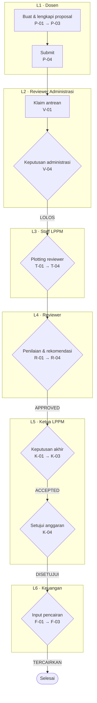
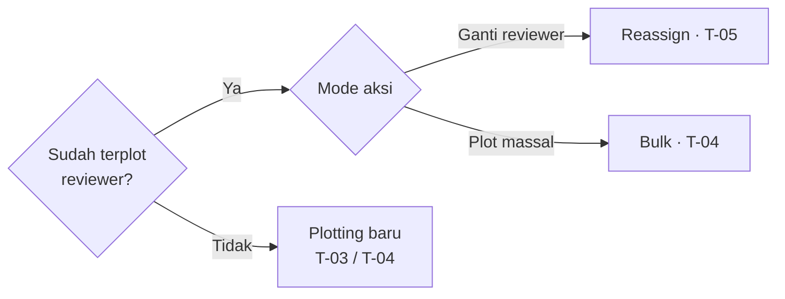
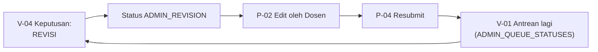
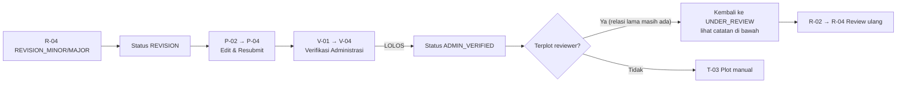

# PRD — Flowchart Swimlane Modul Penelitian

> **Tipe:** Kontrak spesifikasi untuk **pembuatan diagram swimlane (flowchart)** — *bukan* dokumen usulan fitur baru.
> **Sumber:** dibaca langsung dari kode BE `sip3m-be` (branch `main`) pada 26 November 2026.
> **Kode sumber utama:** `src/proposals/proposal.service.ts`, `src/proposals/proposal.routes.ts`, `src/finance/finance.service.ts`, `src/finance/finance.routes.ts`, `prisma/schema.prisma`, `prisma/seed-permissions.ts`.
> **Versi dokumen:** 1.0 · **Tanggal:** 26 November 2026
> **Untuk:** AI/pembuat diagram yang akan menggambar **Flowchart Swimlane Modul Penelitian**.

---

## Cara Membaca Dokumen Ini (wajib dibaca AI pembuat diagram)

Dokumen ini adalah **satu-satunya sumber kebenaran** untuk diagram. Jangan menambah, mengurangi, atau menebak langkah yang tidak tercantum.

### Konvensi penomoran langkah

| Prefiks | Tahap | Lane pemilik |
|---|---|---|
| `P-xx` | 1 · Pengajuan | Dosen |
| `V-xx` | 2 · Verifikasi Administrasi | Reviewer Administrasi |
| `T-xx` | 3 · Plotting Reviewer | Staff LPPM |
| `R-xx` | 4 · Review Ilmiah | Reviewer |
| `K-xx` | 5 · Keputusan Akhir | Ketua LPPM |
| `F-xx` | 6 · Pencairan Dana | Keuangan / Ketua LPPM |
| `S-xx` | Aksi latar (Sistem) | Sistem |

### Konvensi simpul (node)

- **Oval** = mulai/selesai (start/end).
- **Persegi** = proses/aksi oleh aktor di lane-nya.
   - **Belah ketupat (diamond)** = percabangan/keputusan — **wajib** diberi label `Ya` / `Tidak` (atau nama keputusan) pada setiap panah keluar.
- **Garis panah tebal antar-lane** = **handoff** (perpindahan proses ke aktor lain).
- Setiap panah wajib berlabel. Panah tanpa label hanya diizinkan untuk jalur linear lurus dalam lane yang sama.

### Konvensi warna lane (opsional, bila mendukung warna)

| Lane | Saran warna |
|---|---|
| Dosen | Biru |
| Reviewer Administrasi | Oranye |
| Staff LPPM | Hijau |
| Reviewer | Ungu |
| Ketua LPPM | Merah bata |
| Keuangan | Emas |
| Sistem | Abu-abu |

### Aturan keras (hard rules)

1. **Jumlah lane tepat 7** (lihat bagian 1). Tambahkan lane hanya bila Anda menganggap `Sistem` bukan lane — dalam hal itu gabungkan aksi `S-xx` ke dalam lane `Staff LPPM` dan catat asumsi Anda.
2. **Semua status di bagian 5 wajib muncul** sebagai node status (biasanya di dalam belah ketupat atau sebagai label pada edge).
3. **Semua langkah `V-xx`, `T-xx`, `R-xx` punya minimal satu percabangan.**
4. **Handoff wajib digambar sebagai panah yang menyeberang batas lane.**
5. **Tidak ada panah yang melompati tahap.** Urutan tahap: 1 → 2 → 3 → 4 → 5 → 6. Pengecualian hanya jalur pengulangan di bagian 4.
6. Status **`REVISION_PENDING`** dan **`DITOLAK` (pencairan)** adalah **status mati** — jangan digambar sebagai node yang bisa dicapai (lihat bagian 4.8).

---

## 1. Daftar Aktor (Swimlanes)

### 1.1 Peta lane

| # | Lane | Role (sistem) | Peran utama dalam alur | Permission kunci |
|---|---|---|---|---|
| L1 | **Dosen / Ketua Peneliti** | `DOSEN` | Membuat, melengkapi, mengirim, dan merevisi proposal miliknya; menerima notifikasi; menerima dana | `proposal.saya`, `proposal.lihat-detail`, `proposal.lihat-review` |
| L2 | **Reviewer Administrasi** | `REVIEWER_ADMINISTRASI` | Gerbang administrasi: memeriksa kelengkapan berkas via checklist → Lolos / Revisi / Tolak | `proposal.verifikasi-administrasi`, `proposal.lihat`, `proposal.lihat-detail` |
| L3 | **Staff LPPM** | `STAFF_LPPM` | Menentukan reviewer (plotting otomatis, manual, dan reassign) | `proposal.plotting`, `proposal.status`, `proposal.lihat`, `proposal.lihat-detail`, `proposal.lihat-review`, `keuangan.lihat` |
| L4 | **Reviewer** | `REVIEWER` / `REVIEWER_EKSTERNAL` | Menilai proposal (5 aspek) + memberi rekomendasi | `proposal.review`, `proposal.status`, `proposal.lihat`, `proposal.lihat-detail`, `proposal.lihat-review` |
| L5 | **Ketua LPPM** | `KETUA_LPPM` | Keputusan akhir (Terima/Tolak), override verifikasi administrasi, menyetujui anggaran | `proposal.status`, `proposal.plotting`, `proposal.verifikasi-administrasi`, `keuangan.setujui`, `keuangan.lihat` |
| L6 | **Keuangan** | `KEUANGAN` | Input pencairan dana + bukti transfer | `keuangan.cairkan`, `keuangan.lihat`, `keuangan.export` |
| L7 | **Sistem** | — (otomatis) | Notifikasi in-app, pembuatan proyek & milestone otomatis, validasi/race-guard | — |

### 1.2 Catatan peran penting

- **`STAFF_LPPM` memegang permission `proposal.status`, tetapi daftar transisinya KOSONG** (`ROLE_STATUS_TRANSITIONS.STAFF_LPPM = {}`). Artinya Staff LPPM **tidak bisa** mengubah status lewat endpoint umum — perubahan status hanya terjadi lewat aksi khusus (submit, verifikasi, plotting, evaluate, keputusan akhir). **Jangan menggambar Staff LPPM sebagai aktor perubahan status.**
- **`REVIEWER_ADMINISTRASI` tidak punya `proposal.plotting`** — dia tidak boleh muncul di tahap 3.
- **`KEUANGAN` tidak punya `keuangan.setujui`** — persetujuan anggaran **bukan** di lane Keuangan, melainkan di lane Ketua LPPM.
- **`DOSEN` tidak punya `proposal.status`** — Dosen hanya bisa `submit` (endpoint khusus) dan mengedit/hapus draft.
- **Ketua LPPM adalah satu-satunya yang bisa `revoke` (tarik kembali) verifikasi administrasi** — dijaga `requireRole([KETUA_LPPM])`.
- Reviewer internal dan eksternal **memiliki perilaku transisi yang identik** — boleh digambar sebagai **satu lane** dengan dua label role.

---

## 2. Alur Proses End-to-End (6 Tahap Besar)

### 2.1 Ikhtisar tahap

| Tahap | Nama | Lane dominan | Status masuk | Status keluar | Kunci keluar |
|---|---|---|---|---|---|
| **1** | Pengajuan & Submit | L1 Dosen | `DRAFT` | `SUBMITTED` | `PATCH /proposals/:id/submit` |
| **2** | Verifikasi Administrasi | L2 Reviewer Administrasi | `SUBMITTED` / `ADMIN_REVISION` | `ADMIN_VERIFIED` / `ADMIN_REVISION` / `REJECTED` | `POST /proposals/:id/admin-verification` |
| **3** | Plotting Reviewer | L3 Staff LPPM | `ADMIN_VERIFIED` | `UNDER_REVIEW` | `POST /proposals/:id/reviewer` atau `POST /proposals/bulk-assign-reviewers` |
| **4** | Review Ilmiah | L4 Reviewer | `UNDER_REVIEW` | `REVIEW_DONE` / `REVISION` / `REJECTED` | `PUT /proposals/:id/evaluate` |
| **5** | Keputusan Akhir | L5 Ketua LPPM | `REVIEW_DONE` | `ACCEPTED` / `REJECTED` | `PATCH /proposals/:id/status` |
| **6** | Pencairan Dana | L5 → L6 | `disbursement: MENUNGGU_PERSETUJUAN` | `DISETUJUI` → `TERCAIRKAN` | `PATCH /finances/projects/:id/approve` lalu `PATCH /finances/projects/:id/disburse` |

### 2.2 Diagram tingkat tinggi (referensi untuk AI)

> **Catatan untuk AI:** diagram di atas hanyalah kerangka. Diagram final wajib memakai penomoran langkah `P/V/T/R/K/F/S-xx` dari bagian 3 dan seluruh percabangan dari bagian 3–4.

---

## 3. Detail Langkah per Swimlane

Format setiap langkah: **ID · Aktor · Aksi · Prasyarat · Percabangan · Handoff**.

---

### TAHAP 1 — Pengajuan & Submit (Lane L1 · Dosen)

#### `P-01` — Buat proposal draft
- **Aktor:** Dosen
- **Aksi:** `POST /proposals` (multipart: `proposal_file`, `rab_file`) → record dibuat dengan status **`DRAFT`**.
- **Prasyarat:** permission `proposal.saya`.
- **Percabangan:** — (linear).
- **Handoff:** tidak ada — tetap di lane Dosen.

#### `P-02` — Edit draft / unggah berkas
- **Aktor:** Dosen
- **Aksi:** `PUT /proposals/:id` (boleh mengganti `proposal_file` & `rab_file`).
- **Percabangan (decision):**
  - Status saat ini ∈ {`DRAFT`, `REVISION`, `ADMIN_REVISION`} → **Ya**: edit diterima.
  - Selain itu → **Tidak**: `400` *"Hanya proposal berstatus DRAFT, REVISION, atau ADMIN_REVISION yang dapat diedit."*
- **Handoff:** tidak ada.

#### `P-03` — Hapus proposal
- **Aktor:** Dosen (hanya pemilik)
- **Aksi:** `DELETE /proposals/:id`.
- **Percabangan (decision):**
  - `lead_researcher_id` = pemilik? **Tidak** → `403`.
  - Status = `DRAFT`? **Tidak** → `400` *"Hanya proposal dengan status DRAFT yang dapat dihapus."*
  - **Ya** → record terhapus (**terminal — akhir alur**).
- **Handoff:** tidak ada.

#### `P-04` — Submit proposal
- **Aktor:** Dosen
- **Aksi:** `PATCH /proposals/:id/submit` → status menjadi **`SUBMITTED`**, `submitted_at` terisi.
- **Prasyarat (semua wajib, bila gagal `400` dan alur berhenti di lane Dosen):**
  1. `proposal_file_path` terisi.
  2. `rab_file_path` terisi.
  3. Empat isian naratif terisi: **Detail Sumber Data Penelitian**, **Tujuan Penelitian**, **Metode Penelitian**, **Abstrak**.
- **Percabangan (decision):**
  - Prasyarat terpenuhi? **Ya** → status `SUBMITTED`.
  - **Tidak** → `400`, daftar field kurang dilaporkan, **kembali ke `P-02`**.
- **Status awal yang diizinkan:** `DRAFT` | `REVISION` | `ADMIN_REVISION`. Status lain → `400`.
- **Handoff → Lane L2 (Reviewer Administrasi)** ⬆

---

### TAHAP 2 — Verifikasi Administrasi (Lane L2 · Reviewer Administrasi)

**Antrean verifikasi** (`ADMIN_QUEUE_STATUSES`) = status **`SUBMITTED`** atau **`ADMIN_REVISION`**.

#### `V-01` — Buka antrean
- **Aktor:** Reviewer Administrasi
- **Aksi:** `GET /proposals/admin-verification/queue`, `GET .../checklist`, `GET .../stats`, `GET .../history`.
- **Percabangan (decision):**
  - Ada proposal berstatus `SUBMITTED`/`ADMIN_REVISION`? **Ya** → lanjut `V-02`. **Tidak** → **terminal (antrean kosong)**.
- **Handoff:** tidak ada.

#### `V-02` — Klaim proposal
- **Aktor:** Reviewer Administrasi
- **Aksi:** `POST /proposals/:id/admin-verification/claim` → `admin_verifier_id` = dirinya, `admin_claimed_at` terisi.
- **Percabangan (decision):**
  - Sudah diklaim verifikator lain? **Ya** → `409` *"Proposal ini sedang diverifikasi oleh verifikator lain."* → **kembali ke `V-01`** (pilih proposal lain).
  - Klaim menang pada guard DB (`admin_verifier_id IS NULL`)? **Ya** → lanjut `V-03`. **Tidak** → `409` *"baru saja diklaim verifikator lain"* → `V-01`.
- **Handoff:** tidak ada.

#### `V-03` — Lepas klaim (opsional)
- **Aktor:** Reviewer Administrasi (pemilik klaim)
- **Aksi:** `DELETE /proposals/:id/admin-verification/claim`.
- **Percabangan (decision):**
  - Klaim milik saya? **Ya** → `admin_verifier_id` dibersihkan → **kembali ke `V-01`**.
  - **Tidak** → `409` → tetap di `V-02`.
- **Handoff:** tidak ada.

#### `V-04` — Keputusan verifikasi administrasi  ⭐ *percabangan utama tahap ini*
- **Aktor:** Reviewer Administrasi
- **Aksi:** `POST /proposals/:id/admin-verification` dengan `keputusan` ∈ {`LOLOS`, `REVISI`, `TOLAK`}, `checklist[]`, `catatan`.
  - Sistem menyimpan snapshot checklist + jejak verifikator ke tabel riwayat, lalu **melepas klaim** (`admin_verifier_id = null`).
- **Prasyarat:**
  - Proposal wajib masih dalam antrean (`SUBMITTED`/`ADMIN_REVISION`); selain itu → `409`.
  - Jika `keputusan = LOLOS`: **seluruh item checklist wajib dicentang** — ada yang belum → `400` (alur berhenti, tetap di lane L2).
  - Jika `keputusan = REVISI`: `catatan` **wajib** → `400` bila kosong.
  - Jika `keputusan = TOLAK`: alasan **wajib** → `400` bila kosong.
- **Percabangan (decision — 3 cabang):**

  | Cabang | `keputusan` | Status berikutnya | Notifikasi ke Dosen | Handoff |
  |---|---|---|---|---|
  | **A** | `LOLOS` | **`ADMIN_VERIFIED`** | "Proposal Lolos Verifikasi Administrasi" | ➡ **Lane L3 (Staff LPPM)** |
  | **B** | `REVISI` | **`ADMIN_REVISION`** | "Revisi Administrasi" + catatan | ⬅ **kembali ke Lane L1 (`P-02` → `P-04`)** |
  | **C** | `TOLAK` | **`REJECTED`** | "Proposal Ditolak (Administrasi)" + alasan | ⛔ **terminal** |

---

### TAHAP 3 — Plotting Reviewer (Lane L3 · Staff LPPM)

**Prasyarat umum tahap ini:** status = **`ADMIN_VERIFIED`**. Selain itu → `409`.

#### `T-01` — Lihat kandidat reviewer
- **Aktor:** Staff LPPM
- **Aksi:** `GET /proposals/:id/reviewer-candidates` — menampilkan daftar kandidat **dan hasil plotting bila sudah ada**.
- **Percabangan (decision):** — (linear, asisten pemilihan).
- **Handoff:** tidak ada.

#### `T-02` — Pilih mode plotting

**Percabangan (decision — 3 cabang):**

##### Cabang `T-03` — Plot manual (proposal **belum** terplot)
- **Aktor:** Staff LPPM
- **Aksi:** `POST /proposals/:id/reviewer` dengan `reviewerId`.
- **Percabangan (decision) — urutan pemeriksaan:**
  1. **Sudah terplot?** **Ya** → `409` *"Proposal sudah terplot reviewer — gunakan ubah penugasan (PUT ...)"* → arahkan ke `T-05`. *(Pemeriksaan ini didahulukan sebelum cek status.)*
  2. Status ≠ `ADMIN_VERIFIED`? → `409` *"Plotting reviewer hanya bisa dilakukan setelah proposal lolos verifikasi administrasi"*.
  3. Reviewer tidak ditemukan / tidak aktif / bukan role `REVIEWER`/`REVIEWER_EKSTERNAL`? → `404`.
  4. Reviewer = ketua peneliti? → `409` konflik kepentingan.
  5. Reviewer tercatat sebagai anggota tim? → `409` konflik kepentingan.
  6. **Semua lolos** → relasi reviewer dibuat (guard ulang di dalam transaksi agar tidak plot ganda), status → **`UNDER_REVIEW`**, **2 notifikasi** (ke reviewer: *"Admin LPPM menugaskan Anda..."*; ke dosen: *"Proposal Anda sedang ditinjau"*).
- **Handoff → Lane L4 (Reviewer)** ⬆

##### Cabang `T-04` — Plot massal / otomatis
- **Aktor:** Staff LPPM
- **Aksi:** `POST /proposals/bulk-assign-reviewers` — memproses daftar proposal ID, per proposal memakai `reviewerId` tetap **atau** pemilihan otomatis.
- **Logika pemilihan otomatis (bila `reviewerId` tidak dikirim):**
  1. Kumpulkan reviewer aktif role `REVIEWER`/`REVIEWER_EKSTERNAL`, bukan ketua peneliti.
  2. Saring **sebidang** (normalisasi nama fakultas). Tidak ada sebidang → error.
  3. Saring **konflik kepentingan** (nama di `dosen_terlibat`/`nama_anggota`). Semua konflik → error.
  4. **Load balancing:** urutkan menaikkan jumlah beban (`_count.reviewers`), ambil yang paling sedikit.
- **Percabangan (decision) per proposal:**
  - **Sudah terplot** → **SKIP**, dicatat ke daftar `failed` dengan alasan *"sudah terplot"* (lihat bagian 4.5).
  - ReviewerId tidak valid / konflik / tidak ada kandidat → **SKIP** ke `failed`.
  - **Sukses** → relasi dibuat, status → **`UNDER_REVIEW`**, 2 notifikasi (ke reviewer: *"Sistem menugaskan Anda..."*).
  - Setelah loop selesai → respons melaporkan `success[]` dan `failed[]`.
- **Handoff → Lane L4 (Reviewer)** ⬆ *(hanya untuk proposal sukses)*

##### Cabang `T-05` — Reassign (ganti reviewer pada proposal **sudah** terplot)
- **Aktor:** Staff LPPM (juga Ketua LPPM, karena memegang `proposal.plotting`)
- **Aksi:** `PUT /proposals/:id/reviewer` dengan `reviewerId` baru.
- **Percabangan (decision) — urutan pemeriksaan:**
  1. **Belum terplot?** **Ya** → `409` *"Proposal belum terplot reviewer — gunakan assign manual (POST ...)"* → kembali ke `T-03`.
  2. Reviewer baru = reviewer yang sudah ada? → `409` *"Reviewer tersebut sudah menjadi reviewer proposal ini."*
  3. Reviewer tidak valid / bukan role reviewer → `404`.
  4. Konflik kepentingan (ketua peneliti / anggota tim) → `409`.
  5. **Semua lolos** → baris penugasan diperbarui + `created_at` di-reset (waktu penugasan baru).
- **Efek khusus (wajib digambar):**
  - **Status proposal TIDAK berubah** — tetap apa adanya.
  - **TIDAK ada notifikasi in-app** (keputusan produk: notifikasi hanya untuk penugasan awal).
- **Handoff:** **tidak ada handoff status** — bila status masih `ADMIN_VERIFIED`, tetap menunggu transisi ke `UNDER_REVIEW`.

---

### TAHAP 4 — Review Ilmiah (Lane L4 · Reviewer)

#### `R-01` — Buka daftar penugasan
- **Aktor:** Reviewer
- **Aksi:** `GET /proposals/assigned` (permission `proposal.review`) + `GET /proposals/:id` untuk detail.
- **Percabangan (decision):** ada penugasan? **Ya** → `R-02`. **Tidak** → **terminal (antrean kosong)**.
- **Handoff:** tidak ada.

#### `R-02` — Pastikan status siap direview
- **Aktor:** Reviewer
- **Aksi:** pemeriksaan status sebelum menilai.
- **Percabangan (decision):**
  - Status = `UNDER_REVIEW` → **Ya** → lanjut `R-03`.
  - Status = `REVIEW_DONE` → `400` *"Proposal sudah direview dan menunggu keputusan akhir Ketua LPPM."*
  - Status ∈ {`ACCEPTED`, `REJECTED`} → `400` *"Proposal sudah mendapatkan keputusan final dan tidak dapat direview ulang."*
  - Status lain → `400` *"Proposal belum dapat disubmit review."*
- **Handoff:** tidak ada.

#### `R-03` — Isi penilaian
- **Aktor:** Reviewer
- **Aksi:** menilai **5 aspek** — Perumusan, Tinjauan Pustaka, Metode, Anggaran, Luaran — plus kekuatan/kelemahan proposal, rekomendasi akhir, opsional `revision_deadline`. Sistem menghitung `total_score`.
- **Percabangan (decision):** — (input, linear).
- **Handoff:** tidak ada.

#### `R-04` — Kirim keputusan review  ⭐ *percabangan utama tahap ini*
- **Aktor:** Reviewer
- **Aksi:** `PUT /proposals/:id/evaluate` — menyimpan/memperbarui baris review (upsert), mengubah status proposal, membuat notifikasi ke dosen.
- **Percabangan (decision — 3 cabang):**

  | Cabang | `decision` | Status berikutnya | Notifikasi ke Dosen | Handoff |
  |---|---|---|---|---|
  | **A** | `APPROVED` (Layak Didanai) | **`REVIEW_DONE`** | "Review Selesai — Menunggu Keputusan" | ➡ **Lane L5 (Ketua LPPM)** |
  | **B** | `REJECTED` (Tidak Layak Didanai) | **`REJECTED`** | "Proposal Ditolak" | ⛔ **terminal** |
  | **C** | `REVISION_MINOR` / `REVISION_MAJOR` | **`REVISION`** | "Proposal Perlu Revisi" (kecil/besar) + catatan | ⬅ **kembali ke Lane L1 (`P-02` → `P-04`)** — lihat bagian 4.2 |

> **Catatan:** `REJECTED` pada langkah ini adalah **keputusan final reviewer** — tidak melewati Ketua LPPM.

---

### TAHAP 5 — Keputusan Akhir (Lane L5 · Ketua LPPM)

#### `K-01` — Tinjau rekomendasi reviewer
- **Aktor:** Ketua LPPM
- **Aksi:** `GET /proposals` + `GET /proposals/:id/reviews` (permission `proposal.lihat-review`) untuk membaca skor & rekomendasi.
- **Percabangan (decision):** status = `REVIEW_DONE`? **Ya** → `K-02`. **Tidak** → `400` (transisi hanya `REVIEW_DONE` → `ACCEPTED`/`REJECTED`).
- **Handoff:** tidak ada.

#### `K-02` — Putuskan Terima / Tolak  ⭐
- **Aktor:** Ketua LPPM
- **Aksi:** `PATCH /proposals/:id/status` (permission `proposal.status`).
- **Percabangan (decision — 2 cabang):**

  | Cabang | `status` baru | Efek samping (Sistem `S-01`) | Handoff |
  |---|---|---|---|
  | **A** | **`ACCEPTED`** | Notifikasi ke dosen + **auto-buat `PengabdianProject`** | ➡ **Lane L5 (`K-03`) → Lane L6** |
  | **B** | **`REJECTED`** | Notifikasi "Proposal Ditolak" | ⛔ **terminal** |

#### `K-03` — Setujui anggaran proyek
- **Aktor:** Ketua LPPM *(bukan Keuangan)*
- **Aksi:** `PATCH /finances/projects/:id/approve` (permission `keuangan.setujui`).
- **Prasyarat:** proyek pengabdian sudah ada (dibuat otomatis oleh `S-01`).
- **Percabangan (decision):**
  - `disbursement_status` = `DISETUJUI`? → `400` *"sudah disetujui"*.
  - `disbursement_status` = `TERCAIRKAN`? → `400` *"sudah dicairkan, persetujuan anggaran tidak dapat diubah"*.
  - Selain itu → status pencairan → **`DISETUJUI`** + `disbursement_approved_at/by`.
- **Handoff ➡ Lane L6 (Keuangan)**

---

### TAHAP 6 — Pencairan Dana (Lane L6 · Keuangan)

#### `F-01` — Pantau proyek
- **Aktor:** Keuangan
- **Aksi:** `GET /finances/summary`, `GET /finances/projects`, `GET /finances/projects/:id` (permission `keuangan.lihat`), `GET /finances/export/excel` (`keuangan.export`).
- **Percabangan (decision):** status pencairan menunggu persetujuan? → **Ya** → menunggu `K-03`. **Tidak** → lanjut `F-02`.
- **Handoff:** tidak ada.

#### `F-02` — Input pencairan dana  ⭐
- **Aktor:** Keuangan
- **Aksi:** `PATCH /finances/projects/:id/disburse` (permission `keuangan.cairkan`) dengan `realized_amount`, opsional `proof` (upload ke `keuangan/pencairan/<projectId>/...`), opsional `note`.
- **Percabangan (decision) — urutan pemeriksaan:**
  1. `disbursement_status` = `MENUNGGU_PERSETUJUAN`? → `400` *"Anggaran proyek belum disetujui Ketua LPPM."*
  2. `disbursement_status` = `DITOLAK`? → `400` *"Anggaran proyek ditolak."*
  3. `realized_amount` > `funding_request_amount`? → `400` *"realized_amount melebihi funding_request_amount."*
  4. **Semua lolos** → status pencairan → **`TERCAIRKAN`**, `realized_amount`, `disbursed_at/by` terisi.
- **Notifikasi (`S-02`):** ke dosen **hanya pada pencairan pertama** — bukan saat edit nominal ulang.
- **Handoff ➡ Lane L1 (Dosen — penerima dana, akhir alur)** dan **`F-03`**.

#### `F-03` — Selesai
- **Aktor:** Sistem
- **Aksi:** proyek berstatus pencairan `TERCAIRKAN` tercatat dalam ringkasan keuangan (`dana_terserap`).
- **Percabangan:** **terminal — akhir alur end-to-end.**

---

### Aksi Latar (Lane L7 · Sistem)

| ID | Aksi | Pemicu | Efek |
|---|---|---|---|
| `S-01` | Auto-buat proyek + milestone | `PATCH /proposals/:id/status` → `ACCEPTED` | Membuat `PengabdianProject` (`status = PENDING`, `disbursement_status = MENUNGGU_PERSETUJUAN`, `project_code` dari ID proposal) **+ 4 milestone default**: (1) *Tanda Tangan Kontrak* 0%, (2) *Laporan Kemajuan 1* 30%, (3) *Laporan Kemajuan 2* 70%, (4) *Laporan Akhir* 100%. **Idempotent** — tidak membuat ganda bila proyek sudah ada. |
| `S-02` | Notifikasi in-app | Setiap transisi status / plotting / pencairan pertama | Pesan ringkas ke `user_id` terkait (dosen / reviewer). |
| `S-03` | Audit log | `VERIFY_ADMIN` dan aksi lain | Mencatat pelaku, aksi, objek, status SUCCESS/FAILED. |
| `S-04` | Race-guard klaim & plot | `claim`, `assign` (manual/bulk) | `updateMany` + guard field di dalam transaksi — mencegah klaim ganda & plot ganda. |

---

## 4. Alur Pengulangan & Edge Cases

### 4.1 Siklus Revisi Administrasi (loop kecil)

- **Trigger:** `keputusan = REVISI` pada `V-04`.
- **Jalur:** `SUBMITTED`/`ADMIN_REVISION` → `ADMIN_REVISION` → Dosen edit (`P-02`) → resubmit (`P-04`) → `SUBMITTED` → masuk antrean lagi.
- **Batasan:** tidak ada batas jumlah putaran.
- **Terminal tersembunyi:** saat berada di `ADMIN_REVISION`, verifikator juga boleh memilih `TOLAK` → `REJECTED`.

### 4.2 Siklus Revisi Ilmiah (loop besar) ⚠ *paling penting untuk diagram*

**Fakta yang wajib digambar / dicatat:**

1. Keputusan `REVISION_*` **tidak menghapus** baris penugasan reviewer (`proposalReviewers`). Relasi tetap ada sepanjang siklus.
2. Setelah resubmit + lolos verifikasi, status kembali `ADMIN_VERIFIED`, tetapi **proposal sudah terplot**:
   - `T-03` (POST) → `409` *"sudah terplot"* → diarahkan ke `T-05`.
   - `T-04` (bulk) → **di-skip** dan masuk `failed`.
   - `T-05` (PUT reassign) **bisa jalan, tetapi tidak mengubah status**.
3. Untuk kembali bisa dinilai, status harus kembali ke `UNDER_REVIEW`. Jalur yang tersedia di kode: **`PATCH /proposals/:id/status` dengan role `REVIEWER`/`REVIEWER_EKSTERNAL`** yang mengizinkan transisi `ADMIN_VERIFIED → UNDER_REVIEW` (lihat tabel 5.3). Setelah itu reviewer menilai ulang — baris review lama di-**update** (upsert), bukan ditambah.
4. **Rekomendasi untuk diagram:** gambar loop ini sebagai satu blok pengulangan bernama **"Siklus Revisi Ilmiah"** dengan panah kembali ke Tahap 1, dan beri catatan tepi *"relasi reviewer bertahan; status dikembalikan ke UNDER_REVIEW"*.

### 4.3 Penolakan (terminal)

Ada **4 jalur menuju `REJECTED`**, semuanya berakhir (tidak ada transisi keluar):

| # | Sumber | Aktor | Status sebelumnya |
|---|---|---|---|
| 1 | Verifikasi administrasi `TOLAK` | Reviewer Administrasi | `SUBMITTED` / `ADMIN_REVISION` |
| 2 | Review `REJECTED` | Reviewer | `UNDER_REVIEW` |
| 3 | Keputusan akhir `REJECTED` | Ketua LPPM | `REVIEW_DONE` |

> `REJECTED` bersifat **terminal** — tidak ada endpoint yang mengeluarkannya. Bila diagram Anda menampilkan "kirim ulang setelah ditolak", itu **salah**.

### 4.4 Tarik Kembali Verifikasi (override Ketua LPPM)

- **Endpoint:** `POST /proposals/:id/admin-verification/revoke`
- **Aktor:** **hanya Ketua LPPM** (`requireRole` + permission `proposal.verifikasi-administrasi`).
- **Prasyarat:** status **tepat** `ADMIN_VERIFIED`; selain itu → `409`.
- **Efek:** status → **`SUBMITTED`**, `admin_verifier_id`/`admin_claimed_at` dibersihkan, keputusan tercatat sebagai **`TARIK_KEMBALI`**, `catatan` opsional.
- **Handoff:** kembali ke **Tahap 2 (antrean verifikasi)**.
- **Penting:** penarikan **tidak menghapus** relasi reviewer bila sudah ada (kasus ini hanya mungkin bila plotting sudah terjadi lalu status ditarik).

### 4.5 Reassign vs Plot Baru

| Kondisi | Endpoint yang benar | Efek status | Notifikasi |
|---|---|---|---|
| Belum terplot + status `ADMIN_VERIFIED` | `POST /proposals/:id/reviewer` | → `UNDER_REVIEW` | ✅ 2 notifikasi |
| Sudah terplot (status apa pun) | `PUT /proposals/:id/reviewer` | **tidak berubah** | ❌ tanpa notifikasi |
| Sudah terplot, kirim POST | `POST` → **409** *"gunakan PUT"* | — | — |
| Belum terplot, kirim PUT | `PUT` → **409** *"gunakan POST"* | — | — |

- **Konflik kepentingan selalu DIBLOKIR** (kedua arah): reviewer = ketua peneliti, atau nama reviewer muncul di `dosen_terlibat`/`nama_anggota`.
- **Lintas fakultas DIIZINKAN** pada reassign.
- **Bulk:** proposal bermasalah (sudah terplot, reviewerId invalid, konflik, tidak ada kandidat sebidang, tidak punya fakultas) → **di-skip, tidak menggagalkan batch**, dan **dilaporkan per item di `failed`**.

### 4.6 Klaim Antrean (adu klaim)

- Hanya satu verifikator per proposal. Guard DB: `updateMany ... WHERE admin_verifier_id IS NULL`.
- Kalah klaim → `409`, kembali memilih proposal lain.
- `submitAdminVerification` juga menolak bila klaim dipegang orang lain (`409`).
- Klaim dilepas otomatis setelah keputusan dikirim.

### 4.7 Batas Transisi per Role (endpoint umum `PATCH /proposals/:id/status`)

- Hanya role yang punya permission `proposal.status`: **KETUA_LPPM, STAFF_LPPM, REVIEWER, REVIEWER_EKSTERNAL**.
- `DOSEN` dan `REVIEWER_ADMINISTRASI` **tidak** punya permission ini.
- `STAFF_LPPM` memilikinya tetapi **daftar transisinya kosong** → selalu `400`.
- `KETUA_LPPM` **hanya** `REVIEW_DONE → ACCEPTED | REJECTED`.

### 4.8 Status Mati / Tidak Terpakai ⚠

| Status | Kenapa mati | Saran gambar |
|---|---|---|
| `REVISION_PENDING` (ProposalStatus) | **Tidak pernah ditulis** oleh kode mana pun — hanya muncul dalam penghitungan dashboard ("Dalam Review"). | **Jangan digambar** sebagai node yang bisa dicapai. Bila wajib muncul, tandai dengan gaya **dashed** + label *"tidak terpakai"*. |
| `DITOLAK` (StatusPencairanDana) | Hanya ada di enum & guard baca (`400` bila ditolak) — **tidak pernah di-set** oleh endpoint mana pun. | **Jangan digambar** sebagai hasil. Bila wajib muncul, tandai *"tersedia di skema, belum ada pemicu"*.* |

\* `finance.validation.ts` memang menerima `DITOLAK` sebagai **filter query**, bukan sebagai target transisi.

### 4.9 Edge Cases Lain

- **Edit/hapus setelah submit:** `PUT` hanya untuk `DRAFT`/`REVISION`/`ADMIN_REVISION`; `DELETE` hanya untuk `DRAFT`.
- **Reviewer menilai dua kali:** baris review di-upsert — skor lama tertimpa, bukan bertambah.
- **Milestone dobel saat ACCEPTED:** dicegah guard idempotent (`findUnique` by `proposal_id`).
- **Pencairan berulang:** `TERCAIRKAN` masih boleh diedit (nominal/bukti) — selama bukan `MENUNGGU_PERSETUJUAN`/`DITOLAK`. Notifikasi hanya pencairan pertama.
- **Anggaran disetujui setelah dicairkan:** diblokir `400`.
- **Checklist administrasi kosong:** bila master `CHECKLIST_ADMINISTRASI` belum diatur, `LOLOS` → `400` (tidak ada item untuk dicentang).

---

## 5. Tabel Transisi Status

### 5.1 ProposalStatus — `Status Awal | Aksi/Trigger | Aktor | Status Berikutnya`

| # | Status Awal | Aksi / Trigger | Aktor | Status Berikutnya |
|---|---|---|---|---|
| 1 | `DRAFT` | Buat proposal (`POST /proposals`) | Dosen | `DRAFT` *(awal)* |
| 2 | `DRAFT` | Submit (`PATCH /:id/submit`) | Dosen | `SUBMITTED` |
| 3 | `REVISION` | Submit ulang setelah revisi ilmiah | Dosen | `SUBMITTED` |
| 4 | `ADMIN_REVISION` | Submit ulang setelah revisi administrasi | Dosen | `SUBMITTED` |
| 5 | `SUBMITTED` | Verifikasi administrasi `LOLOS` | Reviewer Administrasi | `ADMIN_VERIFIED` |
| 6 | `SUBMITTED` | Verifikasi administrasi `REVISI` | Reviewer Administrasi | `ADMIN_REVISION` |
| 7 | `SUBMITTED` | Verifikasi administrasi `TOLAK` | Reviewer Administrasi | `REJECTED` |
| 8 | `ADMIN_REVISION` | Verifikasi administrasi `LOLOS` | Reviewer Administrasi | `ADMIN_VERIFIED` |
| 9 | `ADMIN_REVISION` | Verifikasi administrasi `REVISI` | Reviewer Administrasi | `ADMIN_REVISION` *(loop)* |
| 10 | `ADMIN_REVISION` | Verifikasi administrasi `TOLAK` | Reviewer Administrasi | `REJECTED` |
| 11 | `ADMIN_VERIFIED` | Tarik kembali (`POST .../revoke`) | **Ketua LPPM** | `SUBMITTED` |
| 12 | `ADMIN_VERIFIED` | Plot manual (`POST /:id/reviewer`) | Staff LPPM / Ketua LPPM | `UNDER_REVIEW` |
| 13 | `ADMIN_VERIFIED` | Plot massal (`POST /bulk-assign-reviewers`) | Staff LPPM / Ketua LPPM | `UNDER_REVIEW` |
| 14 | `ADMIN_VERIFIED` | Ubah status umum (`PATCH /:id/status`) | **Reviewer / Reviewer Eksternal** | `UNDER_REVIEW` |
| 15 | `UNDER_REVIEW` | Evaluate `APPROVED` | Reviewer | `REVIEW_DONE` |
| 16 | `UNDER_REVIEW` | Evaluate `REJECTED` | Reviewer | `REJECTED` |
| 17 | `UNDER_REVIEW` | Evaluate `REVISION_MINOR` / `REVISION_MAJOR` | Reviewer | `REVISION` |
| 18 | `UNDER_REVIEW` | Ubah status umum (`PATCH /:id/status`) | Reviewer / Reviewer Eksternal | `REVISION` |
| 19 | `REVIEW_DONE` | Keputusan akhir **Terima** (`PATCH /:id/status`) | **Ketua LPPM** | `ACCEPTED` |
| 20 | `REVIEW_DONE` | Keputusan akhir **Tolak** (`PATCH /:id/status`) | **Ketua LPPM** | `REJECTED` |
| 21 | `DRAFT` | Hapus proposal (`DELETE /:id`) | Dosen (pemilik) | *(record terhapus)* |
| — | `ACCEPTED` | — | — | **terminal** (masuk pelaksanaan proyek) |
| — | `REJECTED` | — | — | **terminal** |
| — | `REVISION_PENDING` | *(tidak pernah ditulis)* | — | **status mati** — lihat 4.8 |

### 5.2 StatusPencairanDana (pada `PengabdianProjects`)

| # | Status Awal | Aksi / Trigger | Aktor | Status Berikutnya |
|---|---|---|---|---|
| 1 | `MENUNGGU_PERSETUJUAN` | Proyek otomatis dibuat saat proposal `ACCEPTED` | Sistem | `MENUNGGU_PERSETUJUAN` *(awal)* |
| 2 | `MENUNGGU_PERSETUJUAN` | Setujui anggaran (`PATCH /finances/projects/:id/approve`) | **Ketua LPPM** | `DISETUJUI` |
| 3 | `DISETUJUI` | Input pencairan (`PATCH /finances/projects/:id/disburse`) | **Keuangan** | `TERCAIRKAN` |
| 4 | `TERCAIRKAN` | Edit pencairan ulang (nominal/bukti) | Keuangan | `TERCAIRKAN` *(idem)* |
| — | `DITOLAK` | *(tidak pernah ditulis oleh kode)* | — | **status mati** — lihat 4.8 |

**Guard pencairan:** `MENUNGGU_PERSETUJUAN` → `400` (belum disetujui); `DITOLAK` → `400`; `realized_amount > funding_request_amount` → `400`.

### 5.3 Peta role → transisi yang diizinkan pada `PATCH /proposals/:id/status`

| Role | Status awal | Status tujuan yang diizinkan |
|---|---|---|
| `KETUA_LPPM` | `REVIEW_DONE` | `ACCEPTED`, `REJECTED` |
| `STAFF_LPPM` | *(semua)* | **tidak ada** (daftar kosong → selalu `400`) |
| `REVIEWER` | `ADMIN_VERIFIED` | `UNDER_REVIEW` |
| `REVIEWER` | `UNDER_REVIEW` | `REVISION` |
| `REVIEWER_EKSTERNAL` | `ADMIN_VERIFIED` | `UNDER_REVIEW` |
| `REVIEWER_EKSTERNAL` | `UNDER_REVIEW` | `REVISION` |
| Role lain (`DOSEN`, `REVIEWER_ADMINISTRASI`, `KEUANGAN`, `ADMIN_SISTEM`, …) | — | **403** (tidak punya permission `proposal.status`) |

> Transisi lain di luar tabel ini berasal dari **endpoint khusus** (submit, verifikasi administrasi, plotting, evaluate), bukan dari endpoint umum.

---

## Lampiran A — Endpoint Modul Penelitian (untuk referensi label diagram)

| Endpoint | Permission | Aktor | Fungsi |
|---|---|---|---|
| `POST /proposals` | `proposal.saya` | Dosen | Buat draft |
| `PUT /proposals/:id` | `proposal.saya` | Dosen | Edit (DRAFT/REVISION/ADMIN_REVISION) |
| `DELETE /proposals/:id` | `proposal.saya` | Dosen | Hapus (DRAFT saja) |
| `PATCH /proposals/:id/submit` | `proposal.saya` | Dosen | Submit → `SUBMITTED` |
| `GET /proposals/admin-verification/queue` | `proposal.verifikasi-administrasi` | Reviewer Administrasi | Antrean |
| `GET /proposals/admin-verification/checklist` | `proposal.verifikasi-administrasi` | Reviewer Administrasi | Master checklist |
| `GET /proposals/admin-verification/stats` | `proposal.verifikasi-administrasi` | Reviewer Administrasi | Statistik |
| `GET /proposals/admin-verification/history` | `proposal.verifikasi-administrasi` | Reviewer Administrasi | Riwayat keputusan |
| `POST /proposals/:id/admin-verification/claim` | `proposal.verifikasi-administrasi` | Reviewer Administrasi | Klaim |
| `DELETE /proposals/:id/admin-verification/claim` | `proposal.verifikasi-administrasi` | Reviewer Administrasi | Lepas klaim |
| `POST /proposals/:id/admin-verification` | `proposal.verifikasi-administrasi` | Reviewer Administrasi | LOLOS/REVISI/TOLAK |
| `POST /proposals/:id/admin-verification/revoke` | `proposal.verifikasi-administrasi` + `requireRole(KETUA_LPPM)` | **Ketua LPPM** | Tarik → `SUBMITTED` |
| `GET /proposals` | `proposal.lihat` | multi-role | Daftar proposal |
| `GET /proposals/me` | `proposal.saya` | Dosen | Proposal saya |
| `GET /proposals/assigned` | `proposal.review` | Reviewer | Penugasan saya |
| `GET /proposals/:id` | `proposal.lihat-detail` | multi-role | Detail |
| `PATCH /proposals/:id/status` | `proposal.status` | KETUA/STAFF/REVIEWER/REVIEWER_EKSTERNAL | Transisi umum |
| `POST /proposals/bulk-assign-reviewers` | `proposal.plotting` | Staff LPPM / Ketua LPPM | Plot massal |
| `GET /proposals/:id/reviewer-candidates` | `proposal.plotting` | Staff LPPM / Ketua LPPM | Kandidat + hasil plotting |
| `POST /proposals/:id/reviewer` | `proposal.plotting` | Staff LPPM / Ketua LPPM | Plot manual (belum terplot) |
| `PUT /proposals/:id/reviewer` | `proposal.plotting` | Staff LPPM / Ketua LPPM | Reassign (sudah terplot) |
| `PUT /proposals/:id/evaluate` | `proposal.review` | Reviewer | Penilaian 5 aspek |
| `GET /proposals/:id/reviews` | `proposal.lihat-review` | multi-role | Baca hasil review |
| `GET /finances/summary` | `keuangan.lihat` | Keuangan, Staff LPPM, Ketua LPPM | Ringkasan |
| `GET /finances/projects` · `/:id` | `keuangan.lihat` | sama | Daftar / detail proyek |
| `GET /finances/export/excel` | `keuangan.export` | Keuangan, Ketua LPPM | Ekspor |
| `PATCH /finances/projects/:id/approve` | `keuangan.setujui` | **Ketua LPPM** | `MENUNGGU_PERSETUJUAN → DISETUJUI` |
| `PATCH /finances/projects/:id/disburse` | `keuangan.cairkan` | **Keuangan** | `→ TERCAIRKAN` |

---

## Lampiran B — Daftar Periksa untuk AI Pembuat Diagram

Sebelum menganggap diagram selesai, pastikan:

- [ ] Ada **tepat 7 lane** (atau 6 + aksi Sistem digabung, dengan asumsi dicatat).
- [ ] Semua tahap muncul berurutan: **Pengajuan → Verifikasi Administrasi → Plotting → Review → Keputusan Akhir → Pencairan**.
- [ ] Setiap langkah `V-04`, `R-04`, `K-02`, `F-02` punya **semua cabang** (3/3/2/4 cabang).
- [ ] Loop **revisi administrasi** (bagian 4.1) dan **revisi ilmiah** (bagian 4.2) keduanya digambar.
- [ ] **4 jalur `REJECTED`** ditampilkan sebagai terminal.
- [ ] **Tarik kembali** (`ADMIN_VERIFIED → SUBMITTED`, Ketua LPPM) digambar.
- [ ] **Reassign** digambar terpisah dari **plot baru**, dengan catatan *"tanpa perubahan status, tanpa notifikasi"*.
- [ ] **Bulk skip → `failed`** digambar (minimal sebagai label pada jalur bulk).
- [ ] `REVISION_PENDING` **tidak** digambar sebagai node yang bisa dicapai.
- [ ] `DITOLAK` (pencairan) **tidak** digambar sebagai hasil transisi.
- [ ] Persetujuan anggaran berada di lane **Ketua LPPM**, bukan Keuangan.
- [ ] Keputusan akhir **hanya** Ketua LPPM; reviewer hanya memberi rekomendasi (`REVIEW_DONE`).
- [ ] Semua panah **berlabel**.
